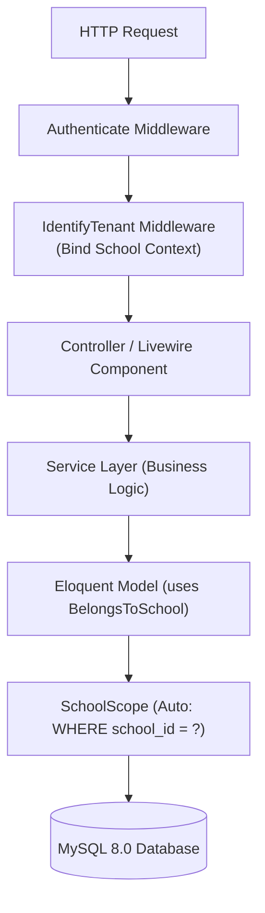
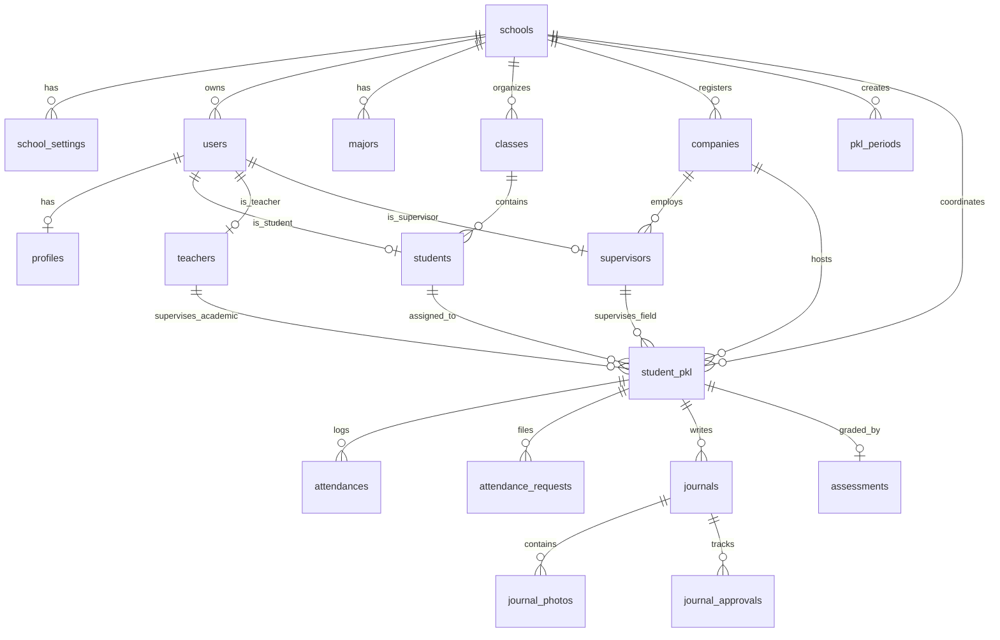

# Technical Design Document (DESIGN.md)
## VokaTrack — Arsitektur & Spesifikasi Rekayasa Sistem

| Parameter | Spesifikasi |
|---|---|
| **Aplikasi** | VokaTrack |
| **Versi Dokumen** | 1.1.0 |
| **Dokumen Acuan** | [PRD-sistem-pkl-smk.md](file:///c:/Users/skala/OneDrive/Documents/project/pkl/PRD-sistem-pkl-smk.md) |
| **Arsitektur** | Single Database Scoped Multi-Tenancy |
| **Framework & Engine** | Laravel 11 (PHP 8.2+), MySQL 8.0, Livewire 3, Tailwind CSS |

---

## 1. Arsitektur Multi-Tenancy & Data Isolation

Sistem menggunakan pola **Single Database with Scoped Tenancy**. Setiap entitas yang berkaitan dengan operasional sekolah terikat pada kolom `school_id`.



### 1.1 Implementasi Core Trait & Global Scope

#### `app/Scopes/SchoolScope.php`
```php
namespace App\Scopes;

use Illuminate\Database\Eloquent\Builder;
use Illuminate\Database\Eloquent\Model;
use Illuminate\Database\Eloquent\Scope;

class SchoolScope implements Scope
{
    public function apply(Builder $builder, Model $model): void
    {
        if (auth()->check() && !auth()->user()->hasRole('super-admin')) {
            $schoolId = auth()->user()->school_id;
            if ($schoolId) {
                $builder->where($model->getTable() . '.school_id', '=', $schoolId);
            }
        }
    }
}
```

#### `app/Traits/BelongsToSchool.php`
```php
namespace App\Traits;

use App\Scopes\SchoolScope;
use App\Models\School;
use Illuminate\Database\Eloquent\Model;
use Illuminate\Database\Eloquent\Relations\BelongsTo;

trait BelongsToSchool
{
    protected static function bootBelongsToSchool(): void
    {
        static::addGlobalScope(new SchoolScope);

        static::creating(function (Model $model) {
            if (empty($model->school_id) && auth()->check() && auth()->user()->school_id) {
                $model->school_id = auth()->user()->school_id;
            }
        });
    }

    public function school(): BelongsTo
    {
        return $this->belongsTo(School::class);
    }
}
```

---

## 2. Skema Basis Data & DDL

### 2.1 Entity Relationship Diagram



### 2.2 Definisi Struktur Tabel (MySQL DDL)

```sql
-- 1. Inti Multi-Sekolah
CREATE TABLE schools (
    id BIGINT UNSIGNED AUTO_INCREMENT PRIMARY KEY,
    npsn VARCHAR(10) NOT NULL UNIQUE,
    name VARCHAR(150) NOT NULL,
    address TEXT NOT NULL,
    phone VARCHAR(20) NOT NULL,
    email VARCHAR(100) NOT NULL,
    logo_path VARCHAR(255) NULL,
    stamp_path VARCHAR(255) NULL,
    is_active BOOLEAN NOT NULL DEFAULT TRUE,
    created_at TIMESTAMP NULL,
    updated_at TIMESTAMP NULL,
    INDEX idx_schools_active (is_active)
) ENGINE=InnoDB DEFAULT CHARSET=utf8mb4 COLLATE=utf8mb4_unicode_ci;

CREATE TABLE school_settings (
    id BIGINT UNSIGNED AUTO_INCREMENT PRIMARY KEY,
    school_id BIGINT UNSIGNED NOT NULL,
    `key` VARCHAR(50) NOT NULL,
    value TEXT NOT NULL,
    created_at TIMESTAMP NULL,
    updated_at TIMESTAMP NULL,
    UNIQUE KEY uk_school_setting (school_id, `key`),
    CONSTRAINT fk_settings_school FOREIGN KEY (school_id) REFERENCES schools (id) ON DELETE CASCADE
) ENGINE=InnoDB DEFAULT CHARSET=utf8mb4 COLLATE=utf8mb4_unicode_ci;

-- 2. Pengguna & Profil
CREATE TABLE users (
    id BIGINT UNSIGNED AUTO_INCREMENT PRIMARY KEY,
    school_id BIGINT UNSIGNED NULL,
    name VARCHAR(100) NOT NULL,
    email VARCHAR(100) NOT NULL UNIQUE,
    password VARCHAR(255) NOT NULL,
    role ENUM('super-admin', 'admin-sekolah', 'kepala-sekolah', 'guru-pembimbing', 'pembimbing-dudi', 'siswa') NOT NULL,
    is_active BOOLEAN NOT NULL DEFAULT TRUE,
    remember_token VARCHAR(100) NULL,
    created_at TIMESTAMP NULL,
    updated_at TIMESTAMP NULL,
    INDEX idx_users_school_role (school_id, role),
    CONSTRAINT fk_users_school FOREIGN KEY (school_id) REFERENCES schools (id) ON DELETE CASCADE
) ENGINE=InnoDB DEFAULT CHARSET=utf8mb4 COLLATE=utf8mb4_unicode_ci;

CREATE TABLE profiles (
    id BIGINT UNSIGNED AUTO_INCREMENT PRIMARY KEY,
    user_id BIGINT UNSIGNED NOT NULL UNIQUE,
    gender ENUM('L', 'P') NOT NULL,
    phone VARCHAR(20) NULL,
    address TEXT NULL,
    avatar_path VARCHAR(255) NULL,
    created_at TIMESTAMP NULL,
    updated_at TIMESTAMP NULL,
    CONSTRAINT fk_profiles_user FOREIGN KEY (user_id) REFERENCES users (id) ON DELETE CASCADE
) ENGINE=InnoDB DEFAULT CHARSET=utf8mb4 COLLATE=utf8mb4_unicode_ci;

-- 3. Master Akademik & Industri
CREATE TABLE majors (
    id BIGINT UNSIGNED AUTO_INCREMENT PRIMARY KEY,
    school_id BIGINT UNSIGNED NOT NULL,
    code VARCHAR(20) NOT NULL,
    name VARCHAR(100) NOT NULL,
    created_at TIMESTAMP NULL,
    updated_at TIMESTAMP NULL,
    INDEX idx_majors_school (school_id),
    CONSTRAINT fk_majors_school FOREIGN KEY (school_id) REFERENCES schools (id) ON DELETE CASCADE
) ENGINE=InnoDB DEFAULT CHARSET=utf8mb4 COLLATE=utf8mb4_unicode_ci;

CREATE TABLE classes (
    id BIGINT UNSIGNED AUTO_INCREMENT PRIMARY KEY,
    school_id BIGINT UNSIGNED NOT NULL,
    major_id BIGINT UNSIGNED NOT NULL,
    name VARCHAR(50) NOT NULL,
    grade_level ENUM('X', 'XI', 'XII') NOT NULL DEFAULT 'XII',
    academic_year VARCHAR(15) NOT NULL,
    created_at TIMESTAMP NULL,
    updated_at TIMESTAMP NULL,
    INDEX idx_classes_school (school_id),
    CONSTRAINT fk_classes_school FOREIGN KEY (school_id) REFERENCES schools (id) ON DELETE CASCADE,
    CONSTRAINT fk_classes_major FOREIGN KEY (major_id) REFERENCES majors (id) ON DELETE RESTRICT
) ENGINE=InnoDB DEFAULT CHARSET=utf8mb4 COLLATE=utf8mb4_unicode_ci;

CREATE TABLE students (
    id BIGINT UNSIGNED AUTO_INCREMENT PRIMARY KEY,
    user_id BIGINT UNSIGNED NOT NULL UNIQUE,
    class_id BIGINT UNSIGNED NOT NULL,
    nis VARCHAR(30) NOT NULL,
    nisn VARCHAR(30) NOT NULL UNIQUE,
    created_at TIMESTAMP NULL,
    updated_at TIMESTAMP NULL,
    CONSTRAINT fk_students_user FOREIGN KEY (user_id) REFERENCES users (id) ON DELETE CASCADE,
    CONSTRAINT fk_students_class FOREIGN KEY (class_id) REFERENCES classes (id) ON DELETE RESTRICT
) ENGINE=InnoDB DEFAULT CHARSET=utf8mb4 COLLATE=utf8mb4_unicode_ci;

CREATE TABLE teachers (
    id BIGINT UNSIGNED AUTO_INCREMENT PRIMARY KEY,
    user_id BIGINT UNSIGNED NOT NULL UNIQUE,
    nip VARCHAR(30) NULL,
    created_at TIMESTAMP NULL,
    updated_at TIMESTAMP NULL,
    CONSTRAINT fk_teachers_user FOREIGN KEY (user_id) REFERENCES users (id) ON DELETE CASCADE
) ENGINE=InnoDB DEFAULT CHARSET=utf8mb4 COLLATE=utf8mb4_unicode_ci;

CREATE TABLE companies (
    id BIGINT UNSIGNED AUTO_INCREMENT PRIMARY KEY,
    school_id BIGINT UNSIGNED NOT NULL,
    name VARCHAR(150) NOT NULL,
    address TEXT NOT NULL,
    contact_person VARCHAR(100) NOT NULL,
    phone VARCHAR(20) NOT NULL,
    gps_enabled BOOLEAN NOT NULL DEFAULT FALSE,
    latitude DECIMAL(10, 8) NULL,
    longitude DECIMAL(11, 8) NULL,
    radius_meters INT UNSIGNED NOT NULL DEFAULT 100,
    override_hours BOOLEAN NOT NULL DEFAULT FALSE,
    custom_work_hours JSON NULL,
    work_days ENUM('5_days', '6_days') NOT NULL DEFAULT '5_days',
    created_at TIMESTAMP NULL,
    updated_at TIMESTAMP NULL,
    INDEX idx_companies_school (school_id),
    CONSTRAINT fk_companies_school FOREIGN KEY (school_id) REFERENCES schools (id) ON DELETE CASCADE
) ENGINE=InnoDB DEFAULT CHARSET=utf8mb4 COLLATE=utf8mb4_unicode_ci;

CREATE TABLE supervisors (
    id BIGINT UNSIGNED AUTO_INCREMENT PRIMARY KEY,
    user_id BIGINT UNSIGNED NOT NULL UNIQUE,
    company_id BIGINT UNSIGNED NOT NULL,
    position VARCHAR(100) NULL,
    created_at TIMESTAMP NULL,
    updated_at TIMESTAMP NULL,
    CONSTRAINT fk_supervisors_user FOREIGN KEY (user_id) REFERENCES users (id) ON DELETE CASCADE,
    CONSTRAINT fk_supervisors_company FOREIGN KEY (company_id) REFERENCES companies (id) ON DELETE CASCADE
) ENGINE=InnoDB DEFAULT CHARSET=utf8mb4 COLLATE=utf8mb4_unicode_ci;

CREATE TABLE pkl_periods (
    id BIGINT UNSIGNED AUTO_INCREMENT PRIMARY KEY,
    school_id BIGINT UNSIGNED NOT NULL,
    name VARCHAR(100) NOT NULL,
    start_date DATE NOT NULL,
    end_date DATE NOT NULL,
    is_active BOOLEAN NOT NULL DEFAULT TRUE,
    created_at TIMESTAMP NULL,
    updated_at TIMESTAMP NULL,
    INDEX idx_periods_school_active (school_id, is_active),
    CONSTRAINT fk_periods_school FOREIGN KEY (school_id) REFERENCES schools (id) ON DELETE CASCADE
) ENGINE=InnoDB DEFAULT CHARSET=utf8mb4 COLLATE=utf8mb4_unicode_ci;

CREATE TABLE student_pkl (
    id BIGINT UNSIGNED AUTO_INCREMENT PRIMARY KEY,
    school_id BIGINT UNSIGNED NOT NULL,
    student_id BIGINT UNSIGNED NOT NULL,
    company_id BIGINT UNSIGNED NOT NULL,
    pkl_period_id BIGINT UNSIGNED NOT NULL,
    teacher_id BIGINT UNSIGNED NOT NULL,
    supervisor_id BIGINT UNSIGNED NULL,
    status ENUM('assigned', 'active', 'completed', 'canceled') NOT NULL DEFAULT 'assigned',
    created_at TIMESTAMP NULL,
    updated_at TIMESTAMP NULL,
    UNIQUE KEY uk_student_period (student_id, pkl_period_id),
    INDEX idx_student_pkl_lookup (school_id, company_id, teacher_id),
    CONSTRAINT fk_spkl_school FOREIGN KEY (school_id) REFERENCES schools (id) ON DELETE CASCADE,
    CONSTRAINT fk_spkl_student FOREIGN KEY (student_id) REFERENCES students (id) ON DELETE CASCADE,
    CONSTRAINT fk_spkl_company FOREIGN KEY (company_id) REFERENCES companies (id) ON DELETE RESTRICT,
    CONSTRAINT fk_spkl_period FOREIGN KEY (pkl_period_id) REFERENCES pkl_periods (id) ON DELETE RESTRICT,
    CONSTRAINT fk_spkl_teacher FOREIGN KEY (teacher_id) REFERENCES teachers (id) ON DELETE RESTRICT,
    CONSTRAINT fk_spkl_supervisor FOREIGN KEY (supervisor_id) REFERENCES supervisors (id) ON DELETE SET NULL
) ENGINE=InnoDB DEFAULT CHARSET=utf8mb4 COLLATE=utf8mb4_unicode_ci;

-- 4. Transaksional Absensi & Jurnal
CREATE TABLE attendances (
    id BIGINT UNSIGNED AUTO_INCREMENT PRIMARY KEY,
    school_id BIGINT UNSIGNED NOT NULL,
    student_pkl_id BIGINT UNSIGNED NOT NULL,
    date DATE NOT NULL,
    status ENUM('hadir', 'terlambat', 'izin', 'sakit', 'dinas_luar', 'luar_kantor', 'alfa') NOT NULL,
    checkin_time TIME NULL,
    checkin_photo_path VARCHAR(255) NULL,
    checkin_lat DECIMAL(10, 8) NULL,
    checkin_lng DECIMAL(11, 8) NULL,
    is_within_radius BOOLEAN NULL,
    checkout_time TIME NULL,
    checkout_notes VARCHAR(255) NULL,
    created_at TIMESTAMP NULL,
    updated_at TIMESTAMP NULL,
    UNIQUE KEY uk_attendance_day (student_pkl_id, date),
    INDEX idx_attendances_report (school_id, date, status),
    CONSTRAINT fk_attendances_school FOREIGN KEY (school_id) REFERENCES schools (id) ON DELETE CASCADE,
    CONSTRAINT fk_attendances_spkl FOREIGN KEY (student_pkl_id) REFERENCES student_pkl (id) ON DELETE CASCADE
) ENGINE=InnoDB DEFAULT CHARSET=utf8mb4 COLLATE=utf8mb4_unicode_ci;

CREATE TABLE attendance_requests (
    id BIGINT UNSIGNED AUTO_INCREMENT PRIMARY KEY,
    school_id BIGINT UNSIGNED NOT NULL,
    student_pkl_id BIGINT UNSIGNED NOT NULL,
    type ENUM('izin', 'sakit', 'dinas_luar', 'luar_kantor') NOT NULL,
    start_date DATE NOT NULL,
    end_date DATE NOT NULL,
    reason TEXT NOT NULL,
    destination_location VARCHAR(255) NULL,
    attachment_path VARCHAR(255) NULL,
    status ENUM('pending', 'approved', 'rejected') NOT NULL DEFAULT 'pending',
    reviewer_id BIGINT UNSIGNED NULL,
    reviewer_role ENUM('guru-pembimbing', 'pembimbing-dudi') NULL,
    reviewer_notes TEXT NULL,
    reviewed_at DATETIME NULL,
    created_at TIMESTAMP NULL,
    updated_at TIMESTAMP NULL,
    INDEX idx_att_requests_queue (school_id, status, type),
    CONSTRAINT fk_att_req_school FOREIGN KEY (school_id) REFERENCES schools (id) ON DELETE CASCADE,
    CONSTRAINT fk_att_req_spkl FOREIGN KEY (student_pkl_id) REFERENCES student_pkl (id) ON DELETE CASCADE,
    CONSTRAINT fk_att_req_reviewer FOREIGN KEY (reviewer_id) REFERENCES users (id) ON DELETE SET NULL
) ENGINE=InnoDB DEFAULT CHARSET=utf8mb4 COLLATE=utf8mb4_unicode_ci;

CREATE TABLE journals (
    id BIGINT UNSIGNED AUTO_INCREMENT PRIMARY KEY,
    school_id BIGINT UNSIGNED NOT NULL,
    student_pkl_id BIGINT UNSIGNED NOT NULL,
    date DATE NOT NULL,
    activity_description TEXT NOT NULL,
    status ENUM('draft', 'submitted', 'review_guru', 'approved', 'revision') NOT NULL DEFAULT 'draft',
    created_at TIMESTAMP NULL,
    updated_at TIMESTAMP NULL,
    UNIQUE KEY uk_journal_day (student_pkl_id, date),
    INDEX idx_journals_status (school_id, status),
    CONSTRAINT fk_journals_school FOREIGN KEY (school_id) REFERENCES schools (id) ON DELETE CASCADE,
    CONSTRAINT fk_journals_spkl FOREIGN KEY (student_pkl_id) REFERENCES student_pkl (id) ON DELETE CASCADE
) ENGINE=InnoDB DEFAULT CHARSET=utf8mb4 COLLATE=utf8mb4_unicode_ci;

CREATE TABLE journal_photos (
    id BIGINT UNSIGNED AUTO_INCREMENT PRIMARY KEY,
    journal_id BIGINT UNSIGNED NOT NULL,
    photo_path VARCHAR(255) NOT NULL,
    caption VARCHAR(255) NULL,
    created_at TIMESTAMP NULL,
    updated_at TIMESTAMP NULL,
    CONSTRAINT fk_jphotos_journal FOREIGN KEY (journal_id) REFERENCES journals (id) ON DELETE CASCADE
) ENGINE=InnoDB DEFAULT CHARSET=utf8mb4 COLLATE=utf8mb4_unicode_ci;

CREATE TABLE journal_approvals (
    id BIGINT UNSIGNED AUTO_INCREMENT PRIMARY KEY,
    journal_id BIGINT UNSIGNED NOT NULL,
    approver_id BIGINT UNSIGNED NOT NULL,
    role_level ENUM('pembimbing-dudi', 'guru-pembimbing') NOT NULL,
    status ENUM('approved', 'revision') NOT NULL,
    notes TEXT NULL,
    created_at TIMESTAMP NOT NULL DEFAULT CURRENT_TIMESTAMP,
    CONSTRAINT fk_japprovals_journal FOREIGN KEY (journal_id) REFERENCES journals (id) ON DELETE CASCADE,
    CONSTRAINT fk_japprovals_user FOREIGN KEY (approver_id) REFERENCES users (id) ON DELETE CASCADE
) ENGINE=InnoDB DEFAULT CHARSET=utf8mb4 COLLATE=utf8mb4_unicode_ci;

CREATE TABLE assessments (
    id BIGINT UNSIGNED AUTO_INCREMENT PRIMARY KEY,
    school_id BIGINT UNSIGNED NOT NULL,
    student_pkl_id BIGINT UNSIGNED NOT NULL UNIQUE,
    score_dudi_discipline DECIMAL(5,2) NOT NULL DEFAULT 0.00,
    score_dudi_technical DECIMAL(5,2) NOT NULL DEFAULT 0.00,
    score_dudi_initiative DECIMAL(5,2) NOT NULL DEFAULT 0.00,
    score_teacher_report DECIMAL(5,2) NOT NULL DEFAULT 0.00,
    final_score DECIMAL(5,2) NOT NULL DEFAULT 0.00,
    notes_dudi TEXT NULL,
    notes_teacher TEXT NULL,
    created_at TIMESTAMP NULL,
    updated_at TIMESTAMP NULL,
    CONSTRAINT fk_assessments_school FOREIGN KEY (school_id) REFERENCES schools (id) ON DELETE CASCADE,
    CONSTRAINT fk_assessments_spkl FOREIGN KEY (student_pkl_id) REFERENCES student_pkl (id) ON DELETE CASCADE
) ENGINE=InnoDB DEFAULT CHARSET=utf8mb4 COLLATE=utf8mb4_unicode_ci;
```

---

## 3. Desain Layanan Bisnis (Service Layer)

### 3.1 Layanan Presensi (`AttendanceService`)

```php
namespace App\Services;

use App\Models\Company;
use App\Models\StudentPkl;
use App\Models\Attendance;
use Carbon\Carbon;
use Illuminate\Validation\ValidationException;

class AttendanceService
{
    public function recordCheckIn(StudentPkl $spkl, array $data): Attendance
    {
        $today = Carbon::today()->toDateString();
        $now = Carbon::now();

        // 1. Cek duplikasi absensi hari ini
        if (Attendance::where('student_pkl_id', $spkl->id)->where('date', $today)->exists()) {
            throw ValidationException::withMessages(['attendance' => 'Presensi hari ini sudah tercatat.']);
        }

        $company = $spkl->company;
        $isWithinRadius = true;

        // 2. Evaluasi GPS jika diaktifkan oleh DU/DI
        if ($company->gps_enabled) {
            $distance = $this->calculateHaversineDistance(
                (float) $data['latitude'],
                (float) $data['longitude'],
                (float) $company->latitude,
                (float) $company->longitude
            );

            $isWithinRadius = ($distance <= (float) $company->radius_meters);
        }

        // 3. Evaluasi Jam Masuk & Keterlambatan
        $workHours = $this->resolveWorkHours($company, $spkl->school_id);
        $lateLimit = Carbon::createFromTimeString($workHours['checkin_late']);
        $status = $now->lessThanOrEqualTo($lateLimit) ? 'hadir' : 'terlambat';

        return Attendance::create([
            'school_id' => $spkl->school_id,
            'student_pkl_id' => $spkl->id,
            'date' => $today,
            'status' => $status,
            'checkin_time' => $now->toTimeString(),
            'checkin_photo_path' => $data['photo_path'],
            'checkin_lat' => $data['latitude'],
            'checkin_lng' => $data['longitude'],
            'is_within_radius' => $isWithinRadius,
        ]);
    }

    public function calculateHaversineDistance(float $lat1, float $lon1, float $lat2, float $lon2): float
    {
        $earthRadius = 6371000; // Radius bumi dalam satuan meter
        $dLat = deg2rad($lat2 - $lat1);
        $dLon = deg2rad($lon2 - $lon1);

        $a = sin($dLat / 2) ** 2 +
             cos(deg2rad($lat1)) * cos(deg2rad($lat2)) * (sin($dLon / 2) ** 2);

        $c = 2 * atan2(sqrt($a), sqrt(1 - $a));
        return $earthRadius * $c;
    }

    protected function resolveWorkHours(Company $company, int $schoolId): array
    {
        if ($company->override_hours && !empty($company->custom_work_hours)) {
            return is_string($company->custom_work_hours) 
                ? json_decode($company->custom_work_hours, true) 
                : $company->custom_work_hours;
        }

        return [
            'checkin_start' => '06:00:00',
            'checkin_late'  => '08:00:00',
            'checkout_start'=> '16:00:00',
        ];
    }
}
```

### 3.2 Transisi Status Jurnal (`JournalService`)

```php
namespace App\Services;

use App\Models\Journal;
use App\Models\JournalApproval;
use App\Models\User;
use Illuminate\Validation\ValidationException;

class JournalService
{
    public function approve(Journal $journal, User $approver, ?string $notes = null): Journal
    {
        if ($approver->hasRole('pembimbing-dudi')) {
            if ($journal->status !== 'submitted') {
                throw ValidationException::withMessages(['status' => 'Status jurnal tidak valid untuk review DU/DI.']);
            }
            $nextStatus = 'review_guru';
            $roleLevel = 'pembimbing-dudi';
        } elseif ($approver->hasRole('guru-pembimbing')) {
            if ($journal->status !== 'review_guru') {
                throw ValidationException::withMessages(['status' => 'Jurnal harus disetujui DU/DI terlebih dahulu.']);
            }
            $nextStatus = 'approved';
            $roleLevel = 'guru-pembimbing';
        } else {
            throw ValidationException::withMessages(['role' => 'Pengguna tidak memiliki wewenang approval.']);
        }

        $journal->update(['status' => $nextStatus]);

        JournalApproval::create([
            'journal_id' => $journal->id,
            'approver_id' => $approver->id,
            'role_level' => $roleLevel,
            'status' => 'approved',
            'notes' => $notes,
        ]);

        return $journal;
    }

    public function requestRevision(Journal $journal, User $reviewer, string $notes): Journal
    {
        $roleLevel = $reviewer->hasRole('pembimbing-dudi') ? 'pembimbing-dudi' : 'guru-pembimbing';

        $journal->update(['status' => 'revision']);

        JournalApproval::create([
            'journal_id' => $journal->id,
            'approver_id' => $reviewer->id,
            'role_level' => $roleLevel,
            'status' => 'revision',
            'notes' => $notes,
        ]);

        return $journal;
    }
}
```

---

## 4. Spesifikasi Antarmuka & Token Desain (Tailwind CSS)

### 4.1 Token Warna & Status Sistem

```javascript
// tailwind.config.js
module.exports = {
  theme: {
    extend: {
      colors: {
        brand: {
          50: '#eef2ff',
          100: '#e0e7ff',
          600: '#4f46e5', // Warna utama aplikasi
          700: '#4338ca',
        },
        status: {
          hadir: '#10b981',       // Emerald 500
          terlambat: '#f59e0b',   // Amber 500
          izin: '#3b82f6',        // Blue 500
          sakit: '#8b5cf6',       // Purple 500
          dinas_luar: '#06b6d4',  // Cyan 500
          luar_kantor: '#6366f1', // Indigo 500
          alfa: '#ef4444',        // Red 500
        }
      }
    }
  }
}
```

### 4.2 Struktur Mobile Siswa (`resources/views/layouts/student-mobile.blade.php`)

```html
<!DOCTYPE html>
<html lang="id" class="h-full bg-slate-50">
<head>
    <meta charset="utf-8">
    <meta name="viewport" content="width=device-width, initial-scale=1, maximum-scale=1, user-scalable=no, viewport-fit=cover">
    <title>{{ $title ?? 'VokaTrack Siswa' }}</title>
    @vite(['resources/css/app.css', 'resources/js/app.js'])
</head>
<body class="flex flex-col min-h-full pb-20 antialiased selection:bg-brand-600 selection:text-white">

    <!-- Sticky Header -->
    <header class="sticky top-0 z-30 flex items-center justify-between px-4 py-3 bg-white border-b border-slate-200">
        <div class="flex items-center space-x-3">
            user()->school->logo_url ?? '/images/logo-placeholder.png' }}" class="w-8 h-8 rounded-md object-contain" alt="Logo">
            <div>
                <h1 class="text-sm font-bold text-slate-800 leading-tight">VokaTrack</h1>
                <p class="text-xs text-slate-500 truncate max-w-[200px]">{{ auth()->user()->school->name ?? 'SMK' }}</p>
            </div>
        </div>
        <a href="{{ route('student.notifications') }}" class="p-2 text-slate-600 rounded-full hover:bg-slate-100 relative">
            <svg class="w-5 h-5" fill="none" stroke="currentColor" viewBox="0 0 24 24"><path stroke-linecap="round" stroke-linejoin="round" stroke-width="2" d="M15 17h5l-1.405-1.405A2.032 2.032 0 0118 14.158V11a6.002 6.002 0 00-4-5.659V5a2 2 0 10-4 0v.341C7.67 6.165 6 8.388 6 11v3.159c0 .538-.214 1.055-.595 1.436L4 17h5m6 0v1a3 3 0 11-6 0v-1m6 0H9"/></svg>
        </a>
    </header>

    <!-- Main Content Slot -->
    <main class="flex-1 px-4 py-4 space-y-4">
        {{ $slot }}
    </main>

    <!-- Fixed Bottom Navigation Bar -->
    <nav class="fixed bottom-0 left-0 right-0 z-40 bg-white/95 backdrop-blur-md border-t border-slate-200" style="padding-bottom: env(safe-area-inset-bottom);">
        <div class="grid grid-cols-4 h-16">
            <a href="{{ route('student.home') }}" class="inline-flex flex-col items-center justify-center text-xs font-medium {{ request()->routeIs('student.home') ? 'text-brand-600' : 'text-slate-500' }}">
                <svg class="w-6 h-6 mb-0.5" fill="none" stroke="currentColor" viewBox="0 0 24 24"><path stroke-linecap="round" stroke-linejoin="round" stroke-width="2" d="M3 12l2-2m0 0l7-7 7 7M5 10v10a1 1 0 001 1h3m10-11l2 2m-2-2v10a1 1 0 01-1 1h-3m-6 0a1 1 0 001-1v-4a1 1 0 011-1h2a1 1 0 011 1v4a1 1 0 001 1m-6 0h6"/></svg>
                Beranda
            </a>
            <a href="{{ route('student.attendance') }}" class="inline-flex flex-col items-center justify-center text-xs font-medium {{ request()->routeIs('student.attendance*') ? 'text-brand-600' : 'text-slate-500' }}">
                <svg class="w-6 h-6 mb-0.5" fill="none" stroke="currentColor" viewBox="0 0 24 24"><path stroke-linecap="round" stroke-linejoin="round" stroke-width="2" d="M8 7V3m8 4V3m-9 8h10M5 21h14a2 2 0 002-2V7a2 2 0 00-2-2H5a2 2 0 00-2 2v12a2 2 0 002 2z"/></svg>
                Absensi
            </a>
            <a href="{{ route('student.journals') }}" class="inline-flex flex-col items-center justify-center text-xs font-medium {{ request()->routeIs('student.journals*') ? 'text-brand-600' : 'text-slate-500' }}">
                <svg class="w-6 h-6 mb-0.5" fill="none" stroke="currentColor" viewBox="0 0 24 24"><path stroke-linecap="round" stroke-linejoin="round" stroke-width="2" d="M9 12h6m-6 4h6m2 5H7a2 2 0 01-2-2V5a2 2 0 012-2h5.586a1 1 0 01.707.293l5.414 5.414a1 1 0 01.293.707V19a2 2 0 01-2 2z"/></svg>
                Jurnal
            </a>
            <a href="{{ route('student.profile') }}" class="inline-flex flex-col items-center justify-center text-xs font-medium {{ request()->routeIs('student.profile') ? 'text-brand-600' : 'text-slate-500' }}">
                <svg class="w-6 h-6 mb-0.5" fill="none" stroke="currentColor" viewBox="0 0 24 24"><path stroke-linecap="round" stroke-linejoin="round" stroke-width="2" d="M16 7a4 4 0 11-8 0 4 4 0 018 0zM12 14a7 7 0 00-7 7h14a7 7 0 00-7-7z"/></svg>
                Profil
            </a>
        </div>
    </nav>
</body>
</html>
```

---

## 5. Matriks Routing & Proteksi Middleware

| URI Prefix | Middleware Stack | Target Role | Handler Namespace |
|---|---|---|---|
| `/super-admin/*` | `auth`, `verified`, `role:super-admin` | Super Admin | `App\Http\Controllers\SuperAdmin\` |
| `/admin-sekolah/*` | `auth`, `verified`, `role:admin-sekolah`, `IdentifyTenant` | Admin Sekolah | `App\Http\Controllers\AdminSekolah\` |
| `/guru/*` | `auth`, `verified`, `role:guru-pembimbing`, `IdentifyTenant` | Guru Pembimbing | `App\Http\Controllers\Teacher\` |
| `/dudi/*` | `auth`, `verified`, `role:pembimbing-dudi`, `IdentifyTenant` | Pembimbing DU/DI | `App\Http\Controllers\Supervisor\` |
| `/siswa/*` | `auth`, `verified`, `role:siswa`, `IdentifyTenant` | Siswa (Mobile) | `App\Http\Controllers\Student\` |

---

## 6. Prosedur Penjadwalan Sistem (Scheduled Commands)

### 6.1 Evaluasi Alfa Otomatis (`app/Console/Commands/EvaluateDailyAbsence.php`)
- **Jadwal Eksekusi**: Setiap hari kerja pukul `23:55` server time.
- **Logika**:
  1. Ambil seluruh record `student_pkl` berstatus `active`.
  2. Cek apakah hari ini merupakan hari libur atau di luar hari kerja perusahaan yang ditugaskan.
  3. Jika hari kerja aktif dan tidak ditemukan record di tabel `attendances` (atau pengajuan presensi khusus disetujui), buat record `attendances` baru dengan status `alfa`.
