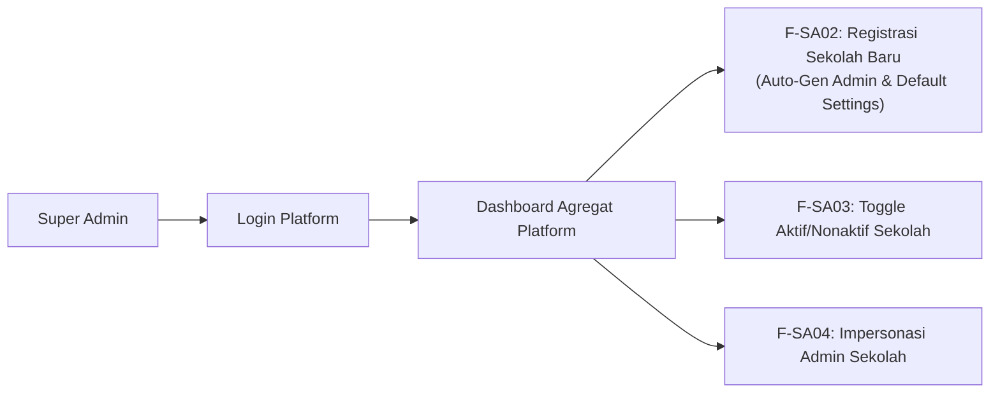
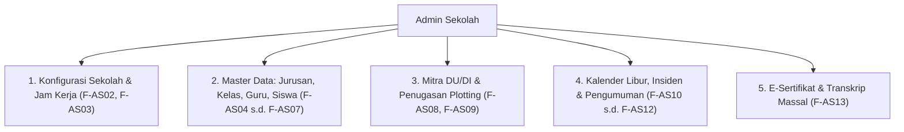
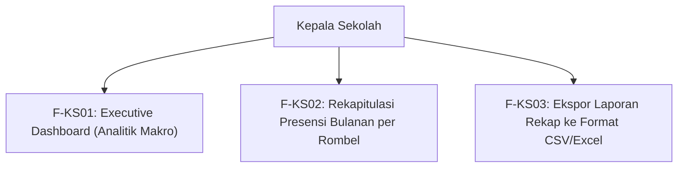
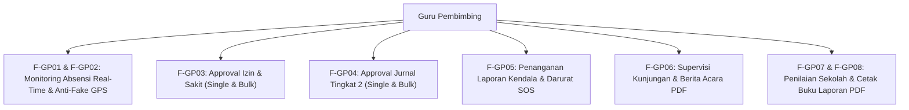
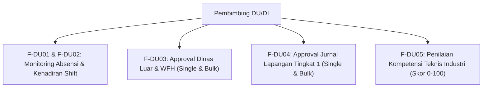
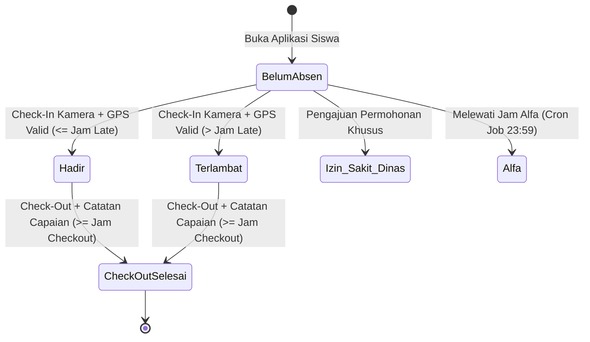
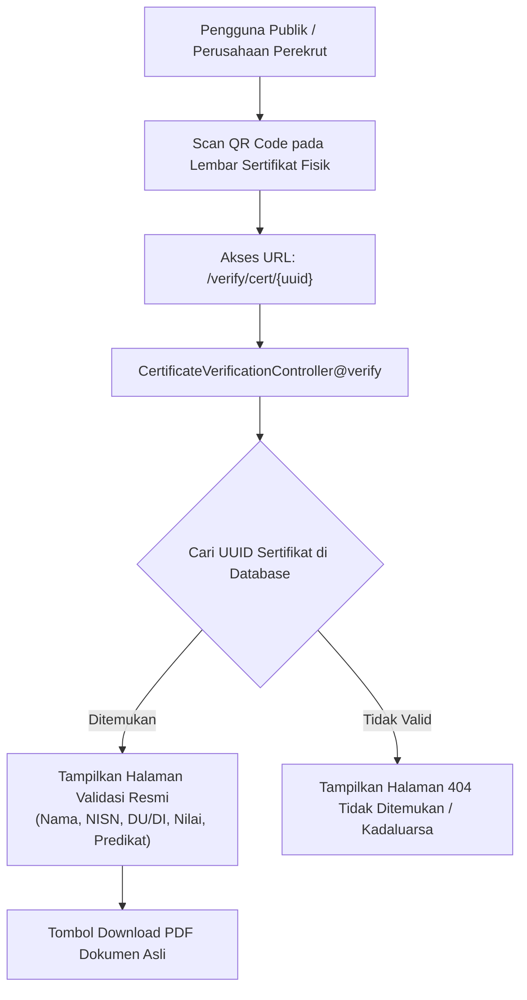
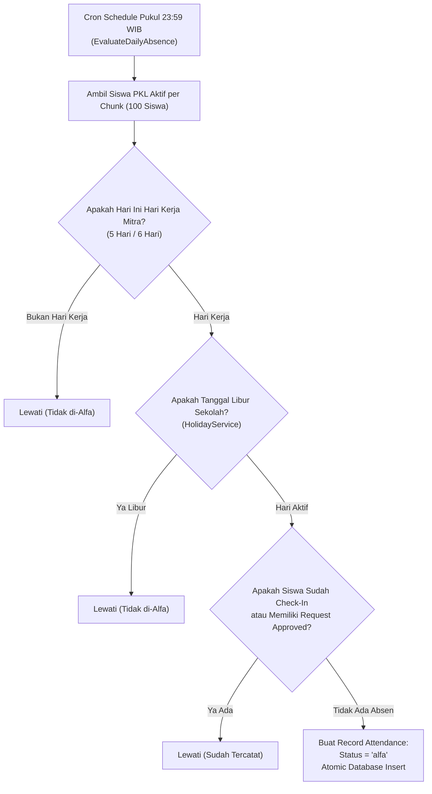

# Dokumentasi Fitur Lengkap VokaTrack Berbagai Level Pengguna

| Parameter | Spesifikasi Sistem |
|---|---|
| **Aplikasi** | **VokaTrack** — Sistem Presensi, Jurnal & Sertifikasi PKL SMK Multi-Sekolah |
| **Versi Rilis** | 2.1.0-Production Ready |
| **Arsitektur Inti** | Single Database Scoped Multi-Tenancy (`school_id`) |
| **Framework & Engine** | Laravel 11 (PHP 8.2+), MySQL 8.0, Blade & Livewire 3 Components, Tailwind CSS, DomPDF |
| **Prinsip Perancangan** | **Scalable** (Tenant Scoping, Chunked Jobs), **Modular** (Dedicated Service Layers), **Mudah di Maintenance** (Single Responsibility & Decoupled Architecture), **Konsisten UI** (Unified Design System) |
| **Dokumen Acuan** | [PRD-sistem-pkl-smk.md](file:///c:/Users/skala/OneDrive/Documents/project/pkl/PRD-sistem-pkl-smk.md), [DESIGN.md](file:///c:/Users/skala/OneDrive/Documents/project/pkl/DESIGN.md), [PLAN-INTEGRASI-LANJUTAN.md](file:///c:/Users/skala/OneDrive/Documents/project/pkl/PLAN-INTEGRASI-LANJUTAN.md) |

---

## Daftar Isi
1. [Arsitektur Sistem & Prinsip Desain](#1-arsitektur-sistem--prinsip-desain)
2. [Matriks Peran & Hak Akses Global (RBAC Matrix)](#2-matriks-peran--hak-akses-global-rbac-matrix)
3. [Level 1: Fitur Super Admin (Platform Manager)](#3-level-1-fitur-super-admin-platform-manager)
4. [Level 2: Fitur Admin Sekolah (School Administrator)](#4-level-2-fitur-admin-sekolah-school-administrator)
5. [Level 3: Fitur Kepala Sekolah (Executive Monitoring)](#5-level-3-fitur-kepala-sekolah-executive-monitoring)
6. [Level 4: Fitur Guru Pembimbing (School Internship Supervisor)](#6-level-4-fitur-guru-pembimbing-school-internship-supervisor)
7. [Level 5: Fitur Pembimbing DU/DI (Industry Workplace Mentor)](#7-level-5-fitur-pembimbing-dudi-industry-workplace-mentor)
8. [Level 6: Fitur Siswa PKL (Mobile-First Experience)](#8-level-6-fitur-siswa-pkl-mobile-first-experience)
9. [Level 7: Fitur Tamu & Publik (Guest & Public Verification)](#9-level-7-fitur-tamu--publik-guest--public-verification)
10. [Otomasi Latar Belakang & Layanan Terjadwal (Background Services & Cron Jobs)](#10-otomasi-latar-belakang--layanan-terjadwal-background-services--cron-jobs)
11. [Panduan Skalabilitas, Pemeliharaan & Konsistensi UI](#11-panduan-skalabilitas-pemeliharaan--konsistensi-ui)

---

## 1. Arsitektur Sistem & Prinsip Desain

VokaTrack dirancang dengan filosofi kejuruan modern yang memadukan mobilitas tinggi siswa di dunia kerja industri dengan tata kelola akademik sekolah vokasi secara akuntabel.

```mermaid
graph TD
    subgraph ClientLayer["1. Antarmuka Klien (UI Tier)"]
        MobileUI["Siswa: Mobile-First Viewport (360-430px)\nSticky Topbar & Fixed Bottom Navigation"]
        DesktopUI["Pengelola: Desktop Multi-Panel Layout\nCollapsible Sidebar, Breadcrumbs, Data Tables"]
        PublicUI["Publik: QR Code Landing Page & Guest Auth"]
    end

    subgraph SecurityLayer["2. Lapisan Keamanan & Tenant (Middleware)"]
        AuthMid["auth: Sanctioned Session"]
        TenantMid["IdentifyTenant: Scope Binding school_id"]
        RoleMid["role: Super Admin / Admin / Kepsek / Guru / DUDI / Siswa"]
        ThrottleMid["throttle: Rate Limiting Guard"]
    end

    subgraph BusinessLayer["3. Service & Modular Business Layer"]
        AttendanceSvc["AttendanceService & GeolocationGuardService"]
        JournalSvc["JournalService (Two-Tier Approval)"]
        CertSvc["CertificateService (QR & PDF Generator)"]
        IncidentSvc["IncidentReportService (Kerahasiaan DU/DI)"]
        SupervisionSvc["SupervisionService (Berita Acara Guru)"]
        HolidaySvc["HolidayService & AnnouncementService"]
    end

    subgraph DataLayer["4. Penyimpanan & Multi-Tenancy (Data Tier)"]
        SchoolScope["Global Scope: WHERE school_id = ?\n(BelongsToSchool Trait)"]
        MySQL[("MySQL 8.0: Isolated Scoped Tables")]
        StorageDisk[("Storage: schools/{school_id}/...")]
    end

    ClientLayer --> SecurityLayer
    SecurityLayer --> BusinessLayer
    BusinessLayer --> DataLayer
```

### 4 Pilar Desain Utama:
1. **Scalable (Skalabilitas Tinggi)**:
   - Skema *Single Database Scoped Multi-Tenancy* meminimalkan overhead koneksi database namun menggaransi isolasi data 100% antar-sekolah melalui global scope `school_id`.
   - Pemrosesan massal (*cron job* penandaan Alfa) menggunakan *chunking* berbasis ID (`chunkById(100)`) dan pencarian data dalam memori (*memoization*) untuk menghindari kehabisan memori (*Out Of Memory*).
   - Pengompresan gambar sisi klien (Web Canvas API ke WebP/JPEG maks 800KB) sebelum transmisi mengurangi beban bandwidth jaringan seluler siswa dan storage server.
2. **Modular (Modularitas Kode)**:
   - Seluruh logika bisnis dipusatkan pada Service Layer independen di `app/Services/`, menjaga Controller tetap ramping (*thin controllers*).
   - Komponen notifikasi menggunakan *Laravel Notification Framework* modular yang terhubung ke tabel `notifications` dan siap dialihkan ke push notification / WhatsApp / Email kapan saja.
3. **Mudah di Maintenance (Maintainability)**:
   - Penerapan *Single Responsibility Principle* (SRP) pada Controller dan Service.
   - Pemanfaatan *Database Transactions* (`DB::transaction()`) dan *Pessimistic Locking* (`lockForUpdate()`) guna mengeliminasi celah *race conditions* saat approval bersamaan atau check-in ganda.
4. **Konsisten UI (UI Consistency)**:
   - Memisahkan komponen UI menjadi library Blade Component reusable (`x-card`, `x-stat-card`, `x-badge`, `x-bulk-action-bar`, `x-empty-state`, `x-image-lightbox`, dll).
   - Standarisasi palet warna status (Hadir = Emerald, Terlambat = Amber, Izin = Blue, Sakit = Rose, Dinas Luar = Violet, Luar Kantor = Sky, Alfa = Slate).

---

## 2. Matriks Peran & Hak Akses Global (RBAC Matrix)

| Modul / Kemampuan Fitur | Super Admin | Admin Sekolah | Kepala Sekolah | Guru Pembimbing | Pembimbing DU/DI | Siswa PKL | Publik |
|---|:---:|:---:|:---:|:---:|:---:|:---:|:---:|
| **Manajemen Sekolah & Tenant** | **CRUD** | - | - | - | - | - | - |
| **Impersonasi Akun (Login As)** | Lintas Tenant | Intra Tenant | - | - | - | - | - |
| **Pengaturan Jam & GPS Sekolah** | - | **CRUD** | Baca | - | - | - | - |
| **Master Data (Jurusan, Kelas, Siswa, Guru)** | - | **CRUD** | Baca | Baca Binaan | - | - | - |
| **Master Mitra DU/DI & Pembimbing** | - | **CRUD** | Baca | Baca Mitra | Profil Sendiri | - | - |
| **Plotting / Penempatan PKL** | - | **CRUD** | Baca | Baca Binaan | Baca Siswanya | - | - |
| **Kalender Libur & Auto-Alfa Filter** | - | **CRUD** | Baca | Baca | - | - | - |
| **Presensi Kamera Selfie & GPS Guard** | - | - | - | - | - | **Create** | - |
| **Approval Izin & Sakit** | - | - | - | **Approval (Tier 1)** | - | Pengajuan | - |
| **Approval Dinas Luar & WFH** | - | - | - | - | **Approval (Tier 1)** | Pengajuan | - |
| **Bulk Action Approval Presensi** | - | - | - | **Ya** | **Ya** | - | - |
| **Pengisian Jurnal Harian** | - | - | - | - | - | **CRUD (Draft/Submit)** | - |
| **Approval Jurnal Lapangan (Teknis)** | - | - | - | - | **Approval (Tier 1)** | - | - |
| **Approval Jurnal Sekolah (Kurikulum)** | - | - | - | **Approval (Tier 2)** | - | - | - |
| **Bulk Action Approval Jurnal** | - | - | - | **Ya** | **Ya** | - | - |
| **Lapor Kendala & Darurat SOS** | - | Follow-up | - | Follow-up Binaan | **Terisolasi (Blokir)** | **Create** | - |
| **Supervisi Lapangan & Berita Acara** | - | - | - | **CRUD & Cetak PDF** | - | - | - |
| **Penilaian Aspek Sekolah** | - | - | - | **Input Nilai** | - | Baca Nilai | - |
| **Penilaian Aspek Industri** | - | - | - | - | **Input Nilai** | Baca Nilai | - |
| **Penerbitan E-Sertifikat PKL** | - | **Batch Generate** | - | - | - | Download PDF | - |
| **Verifikasi Publik Kredensial QR** | - | - | - | - | - | - | **Validasi & Download** |
| **Ekspor Rekapitulasi Presensi** | - | - | **Ekspor CSV/Excel** | **Cetak PDF Siswa** | - | - | - |
| **Broadcast Pengumuman** | - | **Seluruh Sekolah** | - | **Siswa Bimbingan** | - | Baca & Detail | - |

---

## 3. Level 1: Fitur Super Admin (Platform Manager)

Pengguna level Super Admin bertanggung jawab atas ketersediaan platform multi-tenant, registrasi institusi sekolah baru, serta pemantauan integritas sistem lintas sekolah.

### [F-SA01] Dashboard Analitik Agregat Platform
* **Tujuan**: Memberikan visibilitas holistik mengenai adopsi platform di berbagai sekolah.
* **Komponen & Visual**:
  - Kartu Metrik: Total Sekolah Terdaftar, Total Sekolah Aktif, Total Akun Pengguna Global, dan Total Siswa PKL Aktif se-Platform.
  - Tabel Institusi Terbaru: Menampilkan 5 sekolah yang baru mendaftar lengkap dengan jumlah kelas, mitra DU/DI, dan pengguna.
* **File Controller**: [`app/Http/Controllers/SuperAdminController.php@dashboard`](file:///c:/Users/skala/OneDrive/Documents/project/pkl/app/Http/Controllers/SuperAdminController.php)
* **View Blade**: [`resources/views/superadmin/dashboard.blade.php`](file:///c:/Users/skala/OneDrive/Documents/project/pkl/resources/views/superadmin/dashboard.blade.php)

### [F-SA02] Manajemen & Registrasi Sekolah Baru
* **Tujuan**: Mendaftarkan entitas sekolah baru dengan isolasi data terpisah.
* **Input / Form**:
  - `npsn`: Nomor Pokok Sekolah Nasional (Wajib, 8 digit unik).
  - `name`: Nama resmi sekolah (contoh: *SMK Negeri 1 Jakarta*).
  - `address`: Alamat pos sekolah lengkap.
  - `phone`: Nomor telepon instansi.
  - `email`: Email resmi instansi.
  - `admin_name`: Nama lengkap administrator awal sekolah.
  - `admin_email`: Email login admin sekolah (unik pada tabel `users`).
* **Aturan Bisnis & Efek Samping Database**:
  - Dijalankan dalam satu transaksi atomik (`DB::transaction`).
  - Otomatis membuat 1 record di tabel `schools` dengan status `is_active = true`.
  - Otomatis menginisialisasi 12 record konfigurasi default di tabel `school_settings`:
    - `checkin_start` = `06:00:00`, `checkin_late` = `08:00:00`, `checkin_alfa` = `11:00:00`, `checkout_start` = `16:00:00`.
    - `journal_backdate_limit` = `3` hari.
    - `weight_dudi` = `60%`, `weight_guru` = `40%`.
    - Kop surat default: Header Baris 1, Baris 2, Baris 3, nama & NIP kepala sekolah.
  - Otomatis membuat akun user dengan role `admin-sekolah` ber-password default `password`.
* **Rute**: `POST /super-admin/schools` (`superadmin.schools.store`).

### [F-SA03] Toggle Status Aktivasi Sekolah
* **Tujuan**: Menangguhkan (*suspend*) akses operasional sekolah jika masa langganan berakhir atau terjadi pelanggaran kebijakan.
* **Aturan Keamanan**:
  - Jika sekolah diubah menjadi `is_active = false`, seluruh pengguna (`User`) yang memiliki relasi `school_id` tersebut otomatis diblokir saat otentikasi login dengan respon error: *"Akun sekolah Anda sedang dinonaktifkan oleh administrator platform."*
* **Rute**: `POST /super-admin/schools/{school}/toggle` (`superadmin.schools.toggle`).

### [F-SA04] Impersonasi Akun (Login As) Lintas Sekolah
* **Tujuan**: Membantu staf teknis platform dalam mendiagnosis kendala teknis atau komplain langsung dari perspektif Admin Sekolah tanpa menanyakan kata sandi pengguna.
* **Aturan Keamanan**:
  - Super Admin dapat berpindah (*impersonate*) ke pengguna Admin Sekolah manapun.
  - Sesi asli disimpan di `session('impersonator_id')`.
  - Bar notifikasi mengambang (*sticky impersonation bar*) muncul di bagian atas antarmuka dengan tombol `[Kembali ke Akun Saya]`.
* **File Service**: [`app/Services/ImpersonationService.php`](file:///c:/Users/skala/OneDrive/Documents/project/pkl/app/Services/ImpersonationService.php)

### [F-SA05] Manajemen Kuota & Monitoring Ruang Disk (Storage Quota Manager)
* **Tujuan**: Mengukur dan memberlakukan batas pemakaian penyimpanan media (foto selfie absensi, dokumentasi jurnal, scan sertifikat) per sekolah secara riil.
* **Fitur**:
  - Tampilan visual persentase penggunaan storage pada tabel tenant.
  - Penyesuaian batas kuota storage per-sekolah secara instan oleh Super Admin (`POST /super-admin/schools/{school}/storage/quota`) dengan preset cepat (500 MB, 1 GB, 2 GB, 5 GB) dan input manual MB.
  - Fleksibilitas kuota storage khusus saat pendaftaran sekolah baru dan saat perpanjangan/upgrade paket lisensi.
  - Tombol rekonsiliasi hitung ulang pemakaian disk per tenant (`POST /super-admin/schools/{school}/storage/recalculate`).
  - Agregasi kapasitas storage platform global.
* **File Service**: [`app/Services/StorageQuotaService.php`](file:///c:/Users/skala/OneDrive/Documents/project/pkl/app/Services/StorageQuotaService.php)

### [F-SA06] Pusat Audit Trail & Log Keamanan Forensik
* **Tujuan**: Merekam jejak mutasi data krusial, event autentikasi, reset kata sandi, dan aksi impersonasi untuk akuntabilitas kepatuhan sistem.
* **Fitur**:
  - Tabel `activity_logs` dengan pencatatan `action`, `module`, `ip_address`, `user_agent`, serta JSON diff payload before & after.
  - Antarmuka inspeksi log lengkap dengan pencarian teks, filter modul, filter tanggal, dan modal detail JSON.
* **File Service**: [`app/Services/AuditLogService.php`](file:///c:/Users/skala/OneDrive/Documents/project/pkl/app/Services/AuditLogService.php)
* **Rute**: `GET /super-admin/audit-logs` (`superadmin.audit-logs`).

### [F-SA07] Pusat Cadangan Data & Pemulihan (Disaster Recovery & Offboarding Packager)
* **Tujuan**: Mengamankan snapshot basis data platform dan menyediakan ekspor arsip data sekolah yang telah selesai masa kontraknya (*Tenant Offboarding*).
* **Fitur**:
  - Pembuatan snapshot JSON structured backup basis data instan dan unduh berkas backup.
  - *Single-Tenant Offboarding Packager*: Otomatis mengemas data siswa, rekap presensi, jurnal harian, mitra DU/DI, dan profil sekolah ke dalam berkas ZIP terenkripsi.
* **File Service**: [`app/Services/BackupService.php`](file:///c:/Users/skala/OneDrive/Documents/project/pkl/app/Services/BackupService.php)
* **Rute**: `GET /super-admin/backups` (`superadmin.backups`), `GET /super-admin/schools/{school}/offboard-export`.

### [F-SA08] DevOps Dashboard, Antrean & Live Error Log Viewer
* **Tujuan**: Pemantauan stabilitas server, penanganan job antrean yang gagal, dan pembacaan log error aplikasi tanpa akses terminal server.
* **Fitur**:
  - Monitoring tabel `failed_jobs`, detail exception stack trace, retry job, dan flush queue.
  - Pembaca log aktif `storage/logs/laravel.log` dengan filter tingkat severity (*ERROR, WARNING, CRITICAL*).
  - Tombol pintas pembersihan cache konfigurasi, view, route, dan cache aplikasi.
* **Rute**: `GET /super-admin/system` (`superadmin.system-health`).

### [F-SA09] Manajer Siaran Pengumuman Global (Platform Broadcast Manager)
* **Tujuan**: Menayangkan pengumuman maklumat penting, pembaruan fitur, atau jadwal libur serentak ke seluruh antarmuka sekolah mitra.
* **Fitur**:
  - Penjadwalan tanggal penayangan (*starts_at*, *expires_at*).
  - Target peran spesifik (*Semua, Admin Sekolah, Guru Pembimbing, Siswa, Pembimbing DU/DI*).
  - Tipe siaran semantik (*Info, Update, Warning, Emergency*).
  - Banner dismissible di layout desktop dan mobile siswa dengan penyimpanan preferensi tutup di `localStorage`.
* **Model**: [`app/Models/PlatformAnnouncement.php`](file:///c:/Users/skala/OneDrive/Documents/project/pkl/app/Models/PlatformAnnouncement.php)
* **Rute**: `GET /super-admin/broadcasts` (`superadmin.broadcasts`).

### [F-SA10] Pipeline Permohonan Demo & Pendaftaran Mandiri (Onboarding Funnel)
* **Tujuan**: Menampung pengajuan uji coba demo dari calon sekolah mitra melalui landing page dan menyediakan alur aktivasi instan 1-klik.
* **Fitur**:
  - Formulir publik `POST /request-demo` dengan proteksi duplikasi NPSN.
  - Antarmuka antrean verifikasi Super Admin dengan status *Pending, Approved, Rejected*.
  - Aksi *1-Click Approve*: Otomatis membuat entitas `School`, akun `admin-sekolah`, `SchoolSettings` default, dan langganan paket trial.
* **Model**: [`app/Models/SchoolRequest.php`](file:///c:/Users/skala/OneDrive/Documents/project/pkl/app/Models/SchoolRequest.php)
* **Rute**: `GET /super-admin/school-requests` (`superadmin.school-requests`).

---

## 4. Level 2: Fitur Admin Sekolah (School Administrator)

Admin Sekolah merupakan otoritas tertinggi di tingkat institusi sekolah (`school_id`). Mengontrol parameter akademik, mitra industri, penempatan siswa, serta pengesahan dokumen formal.

### [F-AS01] Dashboard Operasional Harian Sekolah
* **Tujuan**: Memberikan ringkasan cepat status operasional PKL sekolah pada hari kerja berjalan.
* **Komponen & Visual**:
  - Metrik Utama: Total Siswa Terdaftar, Total Guru Pembimbing, Total Mitra DU/DI, Total Penugasan PKL Aktif.
  - Kartu Kehadiran Hari Ini: Ringkasan real-time jumlah siswa *Hadir*, *Terlambat*, *Izin*, *Sakit*, dan *Alfa*.
  - Widget Pengumuman Terakhir: Daftar pengumuman aktif dengan pin badge.
* **View Blade**: [`resources/views/adminsekolah/dashboard.blade.php`](file:///c:/Users/skala/OneDrive/Documents/project/pkl/resources/views/adminsekolah/dashboard.blade.php)

### [F-AS02] Identitas & Preferensi Institusi Sekolah
* **Tujuan**: Mengatur visual branding sekolah yang akan dicantumkan secara dinamis pada dokumen formal (Kop Surat, Laporan Cetak, dan E-Sertifikat).
* **Parameter Pengaturan**:
  - Logo Resmi Sekolah (Upload file gambar PNG/JPEG/WEBP/SVG maks 2MB, otomatis disimpan di disk publik).
  - Teks Kop Surat Baris 1, Baris 2, dan Baris 3 (misal: *Pemerintah Provinsi Jawa Barat / Dinas Pendidikan / Cabang Dinas Wilayah I*).
  - Nama Lengkap Kepala Sekolah dan NIP (Nomor Induk Pegawai).
  - Upload Tanda Tangan & Stempel Digital Kepala Sekolah (format PNG transparan untuk stempel sertifikat).
* **Rute**: `GET|POST /admin-sekolah/settings` (`adminsekolah.settings`, `adminsekolah.settings.update`).

### [F-AS03] Pengaturan Jam Kerja & Kebijakan Toleransi Presensi
* **Tujuan**: Menetapkan jam kerja standar sekolah yang menjadi tolok ukur mesin presensi otomatis.
* **Parameter Jam Kerja**:
  - `checkin_start`: Jam awal tombol presensi siswa dapat ditekan (default: `06:00`).
  - `checkin_late`: Batas akhir presensi tepat waktu (default: `08:00`). Presensi setelah waktu ini status menjadi `terlambat`.
  - `checkin_alfa`: Batas toleransi maksimal kehadiran (default: `11:00`). Siswa yang belum absen setelah batas ini diproyeksikan menjadi `alfa`.
  - `checkout_start`: Jam awal siswa diizinkan check-out dan mengisi catatan capaian (default: `16:00`).
  - `journal_backdate_limit`: Batas toleransi pengisian jurnal mundur (default: `3` hari).
  - `weight_dudi` & `weight_guru`: Bobot kalkulasi nilai akhir PKL (default: 60% DU/DI : 40% Guru).

### [F-AS04] Manajemen Jurusan & Rombongan Belajar (Kelas)
* **Tujuan**: Mengorganisasi struktur akademik sekolah vokasi.
* **Fitur & Validasi**:
  - Tambah Jurusan: Kode Jurusan (unik per sekolah, misal: `RPL`, `TKJ`, `AKL`), Nama Jurusan.
  - Tambah Kelas: Nama Rombel (misal: `XII RPL 1`), keterikatan jurusan, dan tahun ajaran aktif.
* **Rute**: `GET /admin-sekolah/majors`, `POST /admin-sekolah/majors`, `POST /admin-sekolah/classes`.

### [F-AS05] Manajemen Periode Pelaksanaan PKL
* **Tujuan**: Menentukan rentang tanggal resmi penempatan PKL (contoh: *Semester Ganjil 2026/2027: 01 Juli 2026 s.d. 31 Desember 2026*).
* **Fitur**:
  - Input: Nama Periode, Tanggal Mulai, Tanggal Selesai.
  - Toggle Aktif: Hanya 1 atau beberapa periode tertentu yang dapat menerima presensi siswa saat ini.
* **Rute**: `POST /admin-sekolah/periods`, `PUT /admin-sekolah/periods/{period}`, `POST /admin-sekolah/periods/{period}/toggle-active`.

### [F-AS06] Manajemen Siswa & Impor Excel Massal
* **Tujuan**: Menghimpun data induk siswa secara cepat tanpa input manual satu per satu.
* **Fitur Impor Excel / CSV**:
  - Format Header: `nis`, `nisn`, `nama`, `kelas_id` / nama rombel, `email`, `jenis_kelamin`.
  - *Row-Level Fault Tolerance*: Baris yang mengandung email atau NISN duplikat akan dicatat ke dalam log baris gagal, tanpa membatalkan baris siswa lain yang valid.
  - Otomatis membuat entitas `User` (role `siswa`), `Profile`, dan `Student`.
* **Rute**: `GET /admin-sekolah/students`, `POST /admin-sekolah/students`, `POST /admin-sekolah/students/import`.

### [F-AS07] Manajemen Guru Pembimbing Sekolah
* **Tujuan**: Mendaftarkan tenaga pendidik yang bertugas membimbing, memonitor, dan mengevaluasi siswa di DU/DI.
* **Input**: NIP, Nama Lengkap Guru, Gelar, Nomor Telepon/WhatsApp, Email Akun.
* **Rute**: `GET /admin-sekolah/teachers`, `POST /admin-sekolah/teachers`.

### [F-AS08] Manajemen Mitra DU/DI & Pembimbing Industri
* **Tujuan**: Mendaftarkan perusahaan mitra dan akun supervisor DU/DI dengan aturan kerja khusus.
* **Fitur Geofencing & Override Kerja**:
  - Data Perusahaan: Nama Industri, Alamat, PIC, Telepon, Hari Kerja Mingguan (`5_hari` Senin-Jumat atau `6_hari` Senin-Sabtu).
  - Geofencing GPS: Koordinat Latitude, Longitude, dan Radius Toleransi dalam meter (default `100` meter).
  - Override Jam Kerja Shift DU/DI: Jika perusahaan mitra memiliki jam operasional berbeda dari sekolah, Admin dapat mengaktifkan jam kerja spesifik DU/DI.
  - Akun Pembimbing DU/DI: Otomatis terhubung dengan satu entitas DU/DI tertentu.
* **Rute**: `GET|POST /admin-sekolah/companies`, `PUT /admin-sekolah/companies/{company}`.

### [F-AS09] Matriks Plotting & Penempatan Siswa PKL
* **Tujuan**: Memetakan relasi 4 arah: Siswa $\leftrightarrow$ Mitra DU/DI $\leftrightarrow$ Guru Pembimbing $\leftrightarrow$ Pembimbing DU/DI pada suatu periode PKL.
* **Fitur & Validasi**:
  - Plotting Massal: Pilih beberapa siswa dalam 1 rombel/jurusan, lalu tetapkan sekaligus ke DU/DI, Guru, dan Supervisor yang dituju.
  - Proteksi Penugasan Ganda: Siswa hanya dapat berstatus `active` di 1 entitas penugasan PKL dalam satu waktu.
* **Rute**: `GET /admin-sekolah/plotting`, `POST /admin-sekolah/plotting`.

### [F-AS10] Kalender Hari Libur Sekolah & Auto-Alfa Filter
* **Tujuan**: Menghindari pemberian status Alfa massal secara keliru kepada siswa saat tanggal merah atau cuti bersama.
* **Fitur**:
  - Sinkronisasi Otomatis Libur Nasional: Mengunduh data hari libur nasional resmi untuk tahun berjalan melalui service [`HolidayService.php`](file:///c:/Users/skala/OneDrive/Documents/project/pkl/app/Services/HolidayService.php).
  - Input Libur Manual: Menambahkan libur khusus sekolah (Ujian Sekolah, Class Meeting, Hari Guru, dll).
* **Rute**: `GET /admin-sekolah/holidays`, `POST /admin-sekolah/holidays`, `DELETE /admin-sekolah/holidays/{holiday}`, `POST /admin-sekolah/holidays/sync-national`.

### [F-AS11] Pengumuman Sekolah
* **Tujuan**: Mengirimkan pengumuman resmi ke seluruh civitas sekolah atau dibatasi per Jurusan tertentu.
* **Fitur**:
  - Target Audiens: Semua Pengguna, Khusus Siswa, Khusus Guru, atau Jurusan Spesifik.
  - Fitur Pinning: Pengumuman penting dapat disematkan (*pinned*) agar selalu tampil paling atas di beranda siswa.
* **Rute**: `GET /admin-sekolah/announcements`, `POST /admin-sekolah/announcements`, `PUT /admin-sekolah/announcements/{announcement}`, `DELETE`, `POST /admin-sekolah/announcements/{announcement}/toggle-pin`.

### [F-AS12] Monitoring Laporan Kendala & Darurat SOS Siswa
* **Tujuan**: Menangani laporan insiden berbahaya (kecelakaan kerja, pelecehan, eksploitasi tugas, toxic environment) yang diajukan siswa.
* **Fitur Kerahasiaan & Tindak Lanjut**:
  - Bersifat rahasia (*strictly hidden*) dari akses akun Pembimbing DU/DI.
  - Admin Sekolah dan Guru Pembimbing dapat mencatat tindak lanjut formal: Investigasi, Mediasi DU/DI, Penarikan Siswa, atau Penanganan Medis.
* **Rute**: `GET /admin-sekolah/incidents`, `POST /admin-sekolah/incidents/{report}/followup`.

### [F-AS13] Generator E-Sertifikat & Transkrip PKL Massal
* **Tujuan**: Menerbitkan sertifikat kelulusan PKL resmi 2 halaman berstandar nasional secara instan.
* **Fitur**:
  - Pembuatan Single & Batch (seluruh siswa dalam satu kelas/periode yang telah dinilai lengkap).
  - Perhitungan Otomatis: Predikat (*Sangat Baik / Baik / Cukup / Kurang*) berdasarkan nilai akhir gabungan DU/DI dan Guru.
  - Penomoran Sertifikat Otomatis: Format `VKT/{NPSN}/{TAHUN}/{NOMOR_URUT}`.
  - QR Code Otentikasi: Mengarahkan pemindai ke halaman verifikasi publik yang valid.
* **File Service**: [`app/Services/CertificateService.php`](file:///c:/Users/skala/OneDrive/Documents/project/pkl/app/Services/CertificateService.php)
* **Rute**: `GET /admin-sekolah/certificates`, `POST /admin-sekolah/certificates/generate`, `POST /admin-sekolah/certificates/batch`, `GET /admin-sekolah/certificates/{certificate}/download`.

### [F-AS14] Impersonasi Pengguna Internal Sekolah
* **Tujuan**: Admin Sekolah dapat login sebagai Guru Pembimbing, Pembimbing DU/DI, atau Siswa di sekolahnya untuk membantu operasional atau memverifikasi tampilan akun yang bermasalah.
* **Batasan**: Tidak dapat mengimpersonasi akun Super Admin atau sesama Admin Sekolah.
* **Rute**: `POST /impersonate/{user}`.

---

## 5. Level 3: Fitur Kepala Sekolah (Executive Monitoring)

Kepala Sekolah memiliki wewenang pemantauan tingkat eksekutif terhadap performa agregat program PKL tanpa dibebani detail teknis harian.

### [F-KS01] Executive Dashboard Analitik Makro
* **Tujuan**: Menyajikan ikhtisar pencapaian pelaksanaan PKL di seluruh konsentrasi keahlian/jurusan.
* **Indikator Kinerja**:
  - Persentase Rata-Rata Kehadiran Siswa (*Attendance Rate* se-Sekolah).
  - Persentase Approval Jurnal (*Journal Clearance Rate* se-Sekolah).
  - Total Siswa Aktif di Industri & Total Mitra Industri yang Menampung Siswa.
  - Distribusi Rombel per Jurusan.
* **View Blade**: [`resources/views/kepsek/dashboard.blade.php`](file:///c:/Users/skala/OneDrive/Documents/project/pkl/resources/views/kepsek/dashboard.blade.php)

### [F-KS02] Rekapitulasi Matriks Presensi Bulanan
* **Tujuan**: Memantau kedisiplinan per rombel kelas pada bulan tertentu dalam bentuk tabel matriks kalender tanggal 1 hingga 31.
* **Visualisasi Matriks**:
  - Setiap sel tanggal menampilkan status: **H** (Hadir), **T** (Terlambat), **I** (Izin), **S** (Sakit), **DL** (Dinas Luar), **LK** (Luar Kantor), **A** (Alfa).
  - Kolom ringkasan akumulatif di ujung kanan tabel menghitung total masing-masing status per siswa.
* **Rute**: `GET /kepala-sekolah/rekap` (`kepsek.rekap`).

### [F-KS03] Ekspor Laporan Rekapitulasi ke CSV / Excel
* **Tujuan**: Mengunduh rekapan data presensi kelas untuk keperluan arsip akreditasi dan evaluasi rapat kurikulum.
* **Karakteristik Output**:
  - File CSV terenkode UTF-8 BOM (`\xEF\xBB\xBF`) sehingga terbuka dengan rapi dan terformat otomatis di Microsoft Excel tanpa masalah encoding.
* **Rute**: `GET /kepala-sekolah/rekap/export` (`kepsek.rekap.export`).

---

## 6. Level 4: Fitur Guru Pembimbing (School Internship Supervisor)

Guru Pembimbing membina kelompok siswa bimbingan yang ditugaskan kepadanya. Menjamin integrasi kompetensi kurikulum sekolah dengan aktivitas nyata di industri.

### [F-GP01] Dashboard Bimbingan Siswa
* **Tujuan**: Pusat kendali kerja harian guru untuk memantau aktivitas bimbingan.
* **Komponen & Notifikasi**:
  - Counter badge: Jumlah jurnal bimbingan yang menunggu verifikasi Guru (*Status: Review Guru*).
  - Counter badge: Permohonan Izin dan Sakit yang menunggu persetujuan.
  - Kartu Siswa Binaan yang Terindikasi Presensi Luar Radius / Mock Location.
* **View Blade**: [`resources/views/teacher/dashboard.blade.php`](file:///c:/Users/skala/OneDrive/Documents/project/pkl/resources/views/teacher/dashboard.blade.php)

### [F-GP02] Monitoring Kehadiran & Geolocation Guard
* **Tujuan**: Memeriksa kehadiran siswa bimbingan hari ini secara detail.
* **Fitur Pemeriksaan**:
  - Menampilkan waktu check-in, foto selfie autentik, koordinat lokasi, dan akurasi GPS dalam meter.
  - *Flagged Attendance Indicator*: Presensi yang menggunakan Fake GPS atau berada di luar batas radius kantor mitra akan diberi tanda merah/kuning mencolok beserta alasan tertulis siswa.
* **Rute**: `GET /guru/monitoring` (`guru.monitoring`).

### [F-GP03] Verifikasi Permohonan Izin & Sakit (Single & Bulk)
* **Tujuan**: Memproses permohonan ketidakhadiran siswa karena alasan medis atau keperluan keluarga.
* **Mekanisme Persetujuan**:
  - **Single Approval**: Modal detail menampilkan alasan tertulis siswa dan foto surat izin/surat keterangan dokter dengan pratinjau gambar via Lightbox. Tombol aksi: `[Setujui]` atau `[Tolak]` dengan catatan wajib.
  - **Bulk Approval**: Disediakan checkbox seleksi di setiap baris tabel. Saat minimal 1 siswa dicentang, *Sticky Floating Action Bar* muncul di bagian bawah layar untuk mengeksekusi persetujuan puluhan siswa dalam 1 kali klik.
* **Rute**: `GET /guru/requests`, `POST /guru/requests/{attRequest}/process`, `POST /guru/requests/bulk`.

### [F-GP04] Verifikasi Jurnal PKL Tingkat 2 (Single & Bulk)
* **Tujuan**: Menilai kesesuaian uraian kerja dan capaian kompetensi siswa dengan kurikulum kejuruan setelah jurnal disetujui oleh Pembimbing Industri.
* **Mekanisme**:
  - Hanya dapat memproses jurnal yang telah berstatus `review_guru` (telah lolos persetujuan DU/DI).
  - Guru dapat memeriksa 1-3 foto dokumentasi pekerjaan siswa yang telah dikompresi.
  - Pilihan Aksi:
    - `Setujui` $\rightarrow$ Status berubah menjadi `approved` (Final).
    - `Minta Revisi` $\rightarrow$ Status berubah menjadi `revision` (Wajib menyertakan catatan poin revisi). Hak edit jurnal di sisi siswa otomatis terbuka kembali.
  - **Bulk Approval Jurnal**: Eksekusi persetujuan massal jurnal-jurnal valid dalam satu transaksi aman.
* **Rute**: `GET /guru/journals`, `POST /guru/journals/{journal}/process`, `POST /guru/journals/bulk`.

### [F-GP05] Penanganan Laporan Kendala & Darurat SOS Siswa
* **Tujuan**: Merespons laporan darurat siswa bimbingan di tempat kerja secara cepat.
* **Tindak Lanjut**:
  - Guru menerima notifikasi instan berstatus `urgent` / `danger`.
  - Guru dapat menginputkan kronologi tindak lanjut dan rekomendasi tindakan (konseling, kunjungan darurat, atau mediasi).
* **Rute**: `GET /guru/incidents`, `POST /guru/incidents/{report}/followup`.

### [F-GP06] Logbook Supervisi Lapangan & Cetak Berita Acara PDF
* **Tujuan**: Mendokumentasikan kunjungan resmi guru ke tempat kerja industri mitra sesuai regulasi kurikulum vokasi Kemendikbudristek.
* **Fitur**:
  - Input Kunjungan: Tahapan (*Monitoring Awal / Tengah / Evaluasi Akhir / Penjemputan*), Tanggal Kunjungan, Ringkasan Perkembangan Siswa, Catatan Masukan DU/DI, Kesepakatan Tindak Lanjut.
  - Unggah Dokumentasi: Foto bersama siswa di lokasi industri dan foto bersama pembimbing DU/DI.
  - Cetak Berita Acara PDF: Menghasilkan dokumen resmi A4 ber-KOP sekolah, memuat narasi hasil supervisi, foto dokumentasi, dan kolom tanda tangan Guru Pembimbing & Pimpinan DU/DI.
* **File Service**: [`app/Services/SupervisionService.php`](file:///c:/Users/skala/OneDrive/Documents/project/pkl/app/Services/SupervisionService.php)
* **Rute**: `GET /guru/supervisions`, `POST /guru/supervisions`, `GET /guru/supervisions/{supervisionVisit}/pdf`.

### [F-GP07] Penilaian Aspek Sekolah
* **Tujuan**: Menginputkan nilai akademik bimbingan siswa PKL.
* **Komponen Penilaian Guru**:
  - Kelengkapan Jurnal Harian.
  - Mutu Buku Laporan Akhir PKL.
  - Presentasi & Sikap selama Pembimbingan Sekolah.
  - Skala nilai: 0 s.d. 100.
* **Rute**: `GET /guru/assessments`, `POST /guru/assessments`.

### [F-GP08] Cetak Buku Laporan PKL Individual Siswa (PDF)
* **Tujuan**: Mencetak dokumen portofolio final PKL siswa secara utuh untuk syarat kelulusan.
* **Muatan Dokumen PDF**:
  - Halaman Judul & Kop Surat Sekolah Dinamis.
  - Lembar Identitas Siswa, Data DU/DI, dan Identitas Pembimbing.
  - Matriks Rekapitulasi Presensi Selama Masa PKL.
  - Kompilasi Seluruh Uraian Jurnal Kegiatan Harian yang telah disetujui (*Approved*).
  - Lembar Transkrip Nilai Gabungan DU/DI & Guru.
  - Lembar Pengesahan Tanda Tangan Pembimbing dan Kepala Sekolah.
* **Rute**: `GET /guru/reports`, `GET /guru/reports/{spkl}/download`.

### [F-GP09] Broadcast Pengumuman Bimbingan
* **Tujuan**: Mengirimkan instruksi atau pengingat batas waktu bimbingan yang tertarget khusus untuk rombongan siswa binaan.
* **Rute**: `GET /guru/announcements`, `POST /guru/announcements`, `PUT`, `DELETE`.

---

## 7. Level 5: Fitur Pembimbing DU/DI (Industry Workplace Mentor)

Pembimbing DU/DI mengawasi siswa secara langsung di lingkungan kerja industri mitra. Bertanggung jawab atas kebenaran teknis kegiatan dan kedisiplinan kerja nyata.

### [F-DU01] Dashboard Industri & Pemantauan Shift
* **Tujuan**: Tampilan ringkas bagi mentor industri untuk melihat siswa yang sedang aktif bekerja di perusahaannya hari ini.
* **Metrik**: Siswa hadir tepat waktu, siswa terlambat, siswa sedang dinas luar/WFH, dan antrean jurnal yang belum diperiksa.
* **View Blade**: [`resources/views/dudi/dashboard.blade.php`](file:///c:/Users/skala/OneDrive/Documents/project/pkl/resources/views/dudi/dashboard.blade.php)

### [F-DU02] Validasi Kehadiran Harian & Indikator Geofence
* **Tujuan**: Memastikan siswa berada di lokasi fisik kantor/pabrik/proyek sesuai radius GPS yang ditentukan.
* **Tampilan Data**: Waktu presensi masuk, waktu kepulangan (check-out), foto selfie terkini, dan jarak aktual perangkat terhadap titik koordinat kantor.
* **Rute**: `GET /dudi/attendances` (`dudi.attendances`).

### [F-DU03] Approval Permohonan Dinas Luar & WFH (Single & Bulk)
* **Tujuan**: Menyetujui penugasan siswa di luar kantor industri mitra.
* **Cakupan Wewenang**:
  - **Dinas Luar**: Siswa ditugaskan ke cabang lain, bertemu klien, instalasi lapangan, atau dinas industri. Membebaskan validasi GPS kantor utama.
  - **Luar Kantor (WFH)**: Siswa bekerja secara remote/hybrid dengan melampirkan foto selfie lokasi aktual dan rencana tugas.
  - Tersedia opsi *Bulk Approval Action Bar* untuk mengesahkan penugasan kelompok siswa sekaligus.
* **Rute**: `GET /dudi/requests`, `POST /dudi/requests/{attRequest}/process`, `POST /dudi/requests/bulk`.

### [F-DU04] Verifikasi Jurnal Lapangan Tingkat 1 (Single & Bulk)
* **Tujuan**: Mengesahkan bahwa uraian teknis dan foto dokumentasi yang diunggah siswa memang benar-benar dikerjakan di tempat kerja industri pada hari tersebut.
* **Siklus Approval**:
  - Jurnal yang masuk berstatus `submitted`.
  - Mentor memeriksa uraian pekerjaan dan foto hasil kerja.
  - Aksi:
    - `Setujui` $\rightarrow$ Status naik ke `review_guru` (diteruskan ke pihak sekolah).
    - `Minta Revisi` $\rightarrow$ Status kembali ke `revision` disertai catatan koreksi teknis.
  - Dilengkapi fitur *Bulk Approval Action Bar* untuk mempercepat review jurnal harian tim magang.
* **Rute**: `GET /dudi/journals`, `POST /dudi/journals/{journal}/process`, `POST /dudi/journals/bulk`.

### [F-DU05] Penilaian Kompetensi Industri Siswa
* **Tujuan**: Memberikan evaluasi performa kerja nyata siswa selama magang di perusahaan.
* **Aspek Penilaian DU/DI**:
  - **Kedisiplinan & Etika Kerja** (`score_dudi_discipline`, skala 0–100).
  - **Keterampilan Teknis / Kualitas Hasil Kerja** (`score_dudi_technical`, skala 0–100).
  - **Inisiatif & Kerja Sama Tim** (`score_dudi_initiative`, skala 0–100).
  - Catatan Evaluasi & Rekomendasi Karir dari Industri.
* **Rute**: `GET /dudi/assessments`, `POST /dudi/assessments`.

---

## 8. Level 6: Fitur Siswa PKL (Mobile-First Experience)

Antarmuka siswa dirancang khusus dengan filosofi *mobile-first mandatory* (viewport 360–430px) untuk penggunaan cepat di lapangan menggunakan smartphone.

### [F-SW01] Mobile Home Dashboard
* **Tujuan**: Menyediakan ringkasan status harian dalam satu layar genggaman tanpa perlu scrolling panjang.
* **Komponen Antarmuka**:
  - **Sticky Topbar**: Logo sekolah, nama siswa, NISN, dan ikon lonceng notifikasi in-app dengan badge merah jika ada notifikasi belum dibaca.
  - **Banner Pengumuman Tersemat**: Pengumuman prioritas dari sekolah atau guru.
  - **Card Status Presensi Hari Ini**: Menampilkan indikator waktu jam masuk, status presensi saat ini, dan tombol dinamis `[ 📷 Check-In ]` atau `[ Check-Out ]`.
  - **Baris Tombol Permohonan Cepat**: Akses 1-sentuhan berbentuk pill: `Izin`, `Sakit`, `Dinas Luar`, `Luar Kantor`.
  - **Card Status Jurnal Hari Ini**: Pengingat visual status jurnal (*Belum Diisi / Draft / Menunggu Review DU/DI / Menunggu Guru / Disetujui*).
  - **Card Rekap Presensi Bulan Berjalan**: Indikator counter: Hadir, Terlambat, Izin, Sakit, Alfa.
  - **Fixed Bottom Navigation**: 4 menu utama: `Beranda`, `Absensi`, `Jurnal`, `Profil`.
* **View Blade**: [`resources/views/student/home.blade.php`](file:///c:/Users/skala/OneDrive/Documents/project/pkl/resources/views/student/home.blade.php)

### [F-SW02] Presensi Selfie, Geofencing & Anti-Fake GPS Guard
* **Tujuan**: Mencegah kecurangan titip absen atau manipulasi lokasi saat check-in di tempat magang.
* **Spesifikasi Teknis**:
  - **Live Camera Stream**: Wajib menggunakan kamera depan langsung via WebRTC API browser. Tombol upload galeri lokal dinonaktifkan untuk mencegah unggahan foto lama.
  - **Akurasi Satelit GPS**: Membaca properti `coords.accuracy` dari Geolocation API. Jika akurasi sinyal satelit melebihi ambang batas toleransi (akurasi > 80 meter), sistem menolak submit dan mengarahkan siswa ke area terbuka untuk kalibrasi.
  - **Deteksi Mock Location / Fake GPS**: Mengidentifikasi flag `is_mocked` dan anomali koordinat 0 meter. Presensi yang terdeteksi fake GPS akan diberi label `[FLAG]` otomatis di dashboard guru.
  - **Kalkulasi Jarak Haversine**: Menghitung jarak presisi antara koordinat siswa dan titik koordinat DU/DI. Jika berada di luar radius kantor, siswa diwajibkan mengisi alasan posisi di luar radius.
  - **Check-Out Presensi**: Tombol aktif setelah memasuki jam `checkout_start`. Siswa wajib mengisi catatan ringkas capaian kerja hari ini (maks 255 karakter).
* **Rute**: `GET /siswa/absensi`, `POST /siswa/checkin`, `POST /siswa/checkout`.

### [F-SW03] Pengajuan Presensi Khusus
* **Tujuan**: Mengajukan izin resmi saat tidak dapat hadir di lokasi kantor fisik.
* **Form & Dokumen**:
  - `Izin`: Alasan tertulis (minimal 20 karakter) + lampiran surat (opsional). Verifikator: Guru Pembimbing.
  - `Sakit`: Alasan tertulis + foto surat keterangan dokter. Verifikator: Guru Pembimbing.
  - `Dinas Luar`: Lokasi tugas industri + uraian penugasan. Verifikator: Pembimbing DU/DI.
  - `Luar Kantor (WFH)`: Foto selfie lokasi kerja aktual + deskripsi rencana kerja harian. Verifikator: Pembimbing DU/DI.
* **Rute**: `POST /siswa/permohonan` (`student.request.store`).

### [F-SW04] Pengisian & Siklus Hidup Jurnal PKL
* **Tujuan**: Merekam aktivitas harian dan kompetensi yang dipelajari siswa di industri.
* **Fitur**:
  - Siklus Status: `Draft` $\rightarrow$ `Submitted` $\rightarrow$ `Review DU/DI` $\rightarrow$ `Review Guru` $\rightarrow$ `Approved` (atau `Revision`).
  - Unggah Foto Kegiatan: 1 hingga 3 foto dokumentasi yang dikompresi otomatis di sisi browser ke WebP/JPEG maks 800KB.
  - Mode Revisi: Jika mentor atau guru meminta revisi, siswa menerima notifikasi beserta catatan revisi dan form otomatis terbuka kembali untuk diperbaiki.
* **Rute**: `GET /siswa/jurnal`, `POST /siswa/jurnal`, `POST /siswa/jurnal/{journal}/submit`.

### [F-SW05] Tombol Lapor Kendala & Darurat SOS
* **Tujuan**: Melindungi keselamatan dan hak-hak siswa magang dari bahaya atau ketidakadilan di tempat kerja.
* **Kategori Masalah**:
  - Pelecehan / Perundungan (*Bullying*).
  - Kecelakaan Kerja / Bahaya Fisik.
  - Ketidaksesuaian Tugas / Eksploitasi di Luar Kompetensi Kejuruan.
  - Lingkungan Kerja Beracun (*Toxic Environment*).
  - Kendala Fasilitas / Transportasi.
* **Prinsip Kerahasiaan Absolut**:
  - Laporan ini **sama sekali tidak dapat dilihat oleh Pembimbing DU/DI** untuk melindungi siswa dari intimidasi di lokasi magang. Laporan hanya diteruskan secara privat kepada Guru Pembimbing dan Admin Sekolah.
* **Rute**: `POST /siswa/lapor-kendala` (`student.incident.store`).

### [F-SW06] Notifikasi In-App & Pengumuman Siswa
* **Tujuan**: Memastikan siswa segera mengetahui respons terhadap permohonan atau jurnal mereka.
* **Fitur**: Notifikasi bertipe database dengan penanda warna (*Approved* = Hijau, *Revisi* = Kuning, *Ditolak* = Merah) dan link langsung ke halaman terkait.
* **Rute**: `GET /siswa/pengumuman`, `GET /siswa/pengumuman/{announcement}`.

### [F-SW07] Profil Siswa & Download E-Sertifikat Digital
* **Tujuan**: Halaman identitas pribadi siswa dan akses dokumen kelulusan PKL.
* **Fitur**: Melihat data penempatan, pembimbing yang bertugas, serta mengunduh E-Sertifikat resmi berformat PDF lengkap dengan transkrip nilai jika telah diterbitkan oleh pihak sekolah.
* **Rute**: `GET /siswa/profil`, `GET /siswa/sertifikat/download`.

---

## 9. Level 7: Fitur Tamu & Publik (Guest & Public Verification)

Menyediakan gerbang autentikasi yang aman serta layanan validasi keaslian dokumen kelulusan PKL bagi instansi eksternal atau dunia kerja.

### [F-PB01] Otentikasi Pengguna & Perlindungan Rate Limiting
* **Tujuan**: Mencegah serangan brute-force credential stuffing pada form login sistem.
* **Aturan Keamanan**:
  - Dilindungi middleware `throttle:5,1` (maksimal 5 percobaan gagal per menit).
  - Mengarahkan pengguna secara otomatis ke dashboard yang tepat berdasarkan role pengguna yang terdaftar.
* **Rute**: `GET /login`, `POST /login`, `POST /logout`.

### [F-PB02] Portal Verifikasi Publik E-Sertifikat PKL (QR Code Destination)
* **Tujuan**: Memverifikasi keabsahan sertifikat PKL fisik atau digital yang ditunjukkan oleh alumni siswa saat melamar pekerjaan.
* **Fitur & Visual**:
  - Halaman publik tanpa perlu login (`/verify/cert/{uuid}`).
  - Menampilkan lencana sertifikasi terverifikasi hijau: Nama Lengkap Siswa, NISN, Nama Sekolah Asal, Nama Perusahaan Mitra DU/DI Tempat PKL, Nilai Akhir, Predikat, dan Tanggal Terbit.
  - Tombol Unduh Dokumen Asli: Pihak ketiga dapat mengunduh salinan resmi dokumen PDF ber-KOP dan tanda tangan digital untuk dicocokkan dengan dokumen fisik.
* **File Controller**: [`app/Http/Controllers/CertificateVerificationController.php`](file:///c:/Users/skala/OneDrive/Documents/project/pkl/app/Http/Controllers/CertificateVerificationController.php)
* **Rute**: `GET /verify/cert/{uuid}`, `GET /verify/cert/{uuid}/download`.

### [F-PB03] Pembaruan Kata Sandi Mandiri (Universal Self-Service Password Change)
* **Tujuan**: Memungkinkan seluruh 6 level peran pengguna (`super-admin`, `admin-sekolah`, `kepala-sekolah`, `guru-pembimbing`, `pembimbing-dudi`, `siswa`) mengganti kata sandi akun mereka sendiri secara mandiri tanpa harus meminta reset manual ke administrator.
* **Fitur & Validasi Keamanan**:
  - Verifikasi keaslian kata sandi lama via aturan `current_password`.
  - Penegakan kata sandi baru: minimal 8 karakter (`min:8`), konfirmasi identik (`confirmed`), dan dilarang sama dengan sandi lama (`different:current_password`).
  - Rekaman jejak audit log keamanan otomatis (`AuditLogService::log`) mencatat mutasi password akun.
  - Komponen antarmuka universal: `<x-change-password-modal />` pada antarmuka desktop (topbar & sidebar footbar) serta kartu profil khusus pada smartphone siswa.
* **Rute**: `POST /profile/change-password` (`profile.change-password`).

---

## 10. Otomasi Latar Belakang & Layanan Terjadwal (Background Services & Cron Jobs)

VokaTrack memiliki mekanisme kecerdasan latar belakang untuk mengeksekusi aturan bisnis otomatis tanpa memerlukan intervensi manual staf sekolah.

### Spesifikasi Teknis Scheduled Command:
* **Signature Command**: `php artisan vokatrack:evaluate-absence`
* **File Implementasi**: [`app/Console/Commands/EvaluateDailyAbsence.php`](file:///c:/Users/skala/OneDrive/Documents/project/pkl/app/Console/Commands/EvaluateDailyAbsence.php)
* **Waktu Eksekusi**: Setiap hari pukul `23:59` server time.
* **Proteksi False-Positive**:
  1. Memeriksa pengaturan hari kerja industri mitra (`5_hari` mengabaikan Sabtu-Minggu, `6_hari` mengabaikan Minggu).
  2. Mengecek status hari libur pada sekolah siswa bersangkutan via `HolidayService`. Jika terdaftar sebagai hari libur (nasional atau libur sekolah), evaluasi dilewati.
  3. Memeriksa apakah siswa memiliki permohonan presensi khusus yang disetujui (`status = approved`) yang mencakup rentang tanggal hari ini.
  4. Hanya siswa tanpa catatan presensi sama sekali pada hari kerja aktif yang ditandai sebagai `alfa`.

---

## 11. Panduan Skalabilitas, Pemeliharaan & Konsistensi UI

### 11.1 Arsitektur Skalabilitas (Scalability Best Practices)
1. **Scoped Multi-Tenancy**: Seluruh Model operasional wajib menggunakan trait [`BelongsToSchool`](file:///c:/Users/skala/OneDrive/Documents/project/pkl/app/Traits/BelongsToSchool.php). Query secara implisit menginjeksi klausa `WHERE school_id = ?`, memastikan indeks database terpakai optimal dan keamanan data antar-sekolah terisolasi total.
2. **Chunking & Memoization**: Operasi massal backend wajib memanfaatkan `chunkById()` dan array lokal memoization untuk mereduksi beban I/O database dan mencegah pemborosan memori RAM.
3. **Pessimistic Concurrency Locking**: Seluruh proses approval jurnal, evaluasi kehadiran, dan penilaian akhir menggunakan `lockForUpdate()` di dalam blok `DB::transaction()` untuk meniadakan risiko benturan data simultan (*race conditions*).

### 11.2 Desain Modularitas & Kemudahan Pemeliharaan (Maintainability)
1. **Pemisahan Lapisan Layanan (Dedicated Service Layers)**:
   - Presensi & GPS: [`AttendanceService.php`](file:///c:/Users/skala/OneDrive/Documents/project/pkl/app/Services/AttendanceService.php), [`GeolocationGuardService.php`](file:///c:/Users/skala/OneDrive/Documents/project/pkl/app/Services/GeolocationGuardService.php).
   - Jurnal Berjenjang: [`JournalService.php`](file:///c:/Users/skala/OneDrive/Documents/project/pkl/app/Services/JournalService.php).
   - Kredensial & Sertifikasi: [`CertificateService.php`](file:///c:/Users/skala/OneDrive/Documents/project/pkl/app/Services/CertificateService.php).
   - Keselamatan & Kendala: [`IncidentReportService.php`](file:///c:/Users/skala/OneDrive/Documents/project/pkl/app/Services/IncidentReportService.php).
   - Supervisi Guru: [`SupervisionService.php`](file:///c:/Users/skala/OneDrive/Documents/project/pkl/app/Services/SupervisionService.php).
   - Kalender & Hari Libur: [`HolidayService.php`](file:///c:/Users/skala/OneDrive/Documents/project/pkl/app/Services/HolidayService.php).
   - Notifikasi Terpusat: [`NotificationService.php`](file:///c:/Users/skala/OneDrive/Documents/project/pkl/app/Services/NotificationService.php).
   - Impersonasi: [`ImpersonationService.php`](file:///c:/Users/skala/OneDrive/Documents/project/pkl/app/Services/ImpersonationService.php).

### 11.3 Standar Konsistensi Antarmuka (UI Consistency Guidelines)
1. **Desain Komponen Reusable Blade**:
   - `x-page-header`: Judul modul seragam dilengkapi breadcrumb dan tombol aksi utama di kanan atas.
   - `x-card`: Kontainer berlatar putih dengan bayangan halus (*soft shadow*) dan radius sudut modern (`rounded-2xl`).
   - `x-stat-card`: Kartu angka metrik seragam dengan ikon berlatar warna senada.
   - `x-bulk-action-bar`: Bar kontrol aksi massal mengambang (*sticky floating bottom bar*) yang muncul otomatis saat baris data dipilih.
   - `x-badge`: Lencana status dengan palet warna terstandarisasi:
     - Hijau (`emerald`): Hadir, Approved, Sangat Baik, Aktif.
     - Kuning (`amber`): Terlambat, Revision, Menunggu Review DU/DI, Moderate Urgency.
     - Biru (`blue`): Izin, Review Guru, Baik.
     - Merah Muda (`rose`): Sakit, Rejected, High Urgency / SOS, Kurang.
     - Abu-abu (`slate`): Alfa, Draft, Selesai.
     - Ungu (`violet`): Dinas Luar.
     - Sian (`sky`): Luar Kantor (WFH).
2. **Kesesuaian Target Perangkat (Viewport Consistency)**:
   - Antarmuka Siswa: Wajib mempertahankan prinsip *Mobile-First* dengan target uji 360–430px (aksesibilitas jempol minimal ukuran tombol 48px, fixed bottom bar 64px, safe-area padding).
   - Antarmuka Pengelola (Admin, Kepsek, Guru, DU/DI): Mempertahankan *Desktop Tablet Multi-Panel* dengan sidebar yang dapat diciutkan (*collapsible*), tabel berkemampuan pagination sisi server, dan modal interaktif.

---

*Dokumen ini disusun sebagai pedoman teknis dan operasional resmi sistem VokaTrack.*
