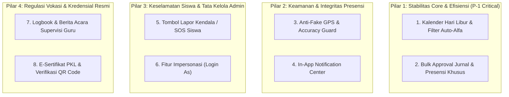
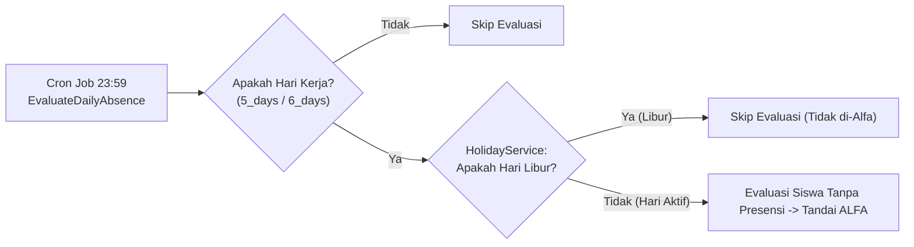
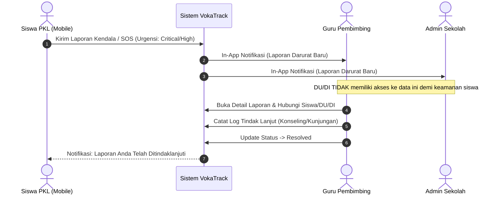
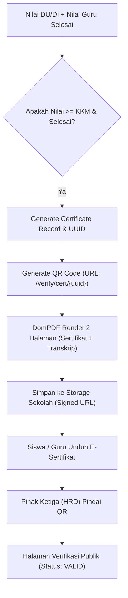

# Dokumen Rencana Integrasi Lanjutan (PLAN-INTEGRASI-LANJUTAN.md)
## VokaTrack — Sistem Presensi & Jurnal PKL SMK Multi-Sekolah

| Parameter | Spesifikasi |
|---|---|
| **Aplikasi** | VokaTrack |
| **Versi Dokumen** | 2.0.0-draft |
| **Status Dokumen** | Approved Architecture Plan |
| **Dokumen Acuan** | [PRD-sistem-pkl-smk.md](file:///c:/Users/skala/OneDrive/Documents/project/pkl/PRD-sistem-pkl-smk.md), [DESIGN.md](file:///c:/Users/skala/OneDrive/Documents/project/pkl/DESIGN.md) |
| **Prinsip Dasar** | **Scalable** (Tenant Scoped, Chunked Queries), **Modular** (Dedicated Service Layers), **Maintainable** (Single Responsibility), **Konsisten UI** (Tailwind Mobile/Desktop Components) |

---

## 1. Ringkasan Eksekutif & Ruang Lingkup Integrasi

Rencana integrasi lanjutan ini disusun untuk menjawab kebutuhan riil operasional lapangan PKL SMK, menambal celah integritas data presensi, serta meningkatkan efisiensi dan keamanan sistem secara holistik. 

Modul-modul yang diintegrasikan dibagi menjadi 4 pilar fungsional:



---

## 2. Rincian Modul Integrasi

### Modul 1: Kalender Hari Libur & Filter Auto-Alfa (P-1 Critical)
* **Tujuan**: Mencegah false-positive penalti `alfa` massal pada siswa saat hari libur nasional, libur semester, atau cuti bersama yang jatuh pada hari kerja.
* **Komponen & Arsitektur**:
  * **Tabel Baru**: `school_holidays` terisolasi per sekolah (`school_id`), dengan flag `is_national` untuk libur bersama.
  * **Service**: `App\Services\HolidayService`.
  * **Integrasi Cron Job**: Modifikasi `app/Console/Commands/EvaluateDailyAbsence.php` agar memeriksa status libur sebelum mengevaluasi absensi.
  * **UI Admin Sekolah**: Kalender mini dan tabel daftar libur dengan aksi tambah manual serta tombol *"Sinkronisasi Libur Nasional Otomatis"*.



---

### Modul 2: Bulk Approval Jurnal & Presensi Khusus (P-1 Critical)
* **Tujuan**: Mengeliminasi bottleneck UX di mana Guru Pembimbing dan Pembimbing DU/DI harus memeriksa puluhan siswa satu per satu setiap hari.
* **Komponen & Arsitektur**:
  * **UI**: Checkbox di setiap baris tabel + *Sticky Batch Floating Action Bar* di bagian bawah layar saat minimal 1 baris dicentang.
  * **Aksi Cepat**:
    * `[Setujui Semua Terpilih]` -> Modal konfirmasi -> Eksekusi batch transaction.
    * `[Minta Revisi Massal]` -> Modal input catatan revisi seragam -> Eksekusi batch transaction.
  * **Service Method**:
    * `JournalService::bulkProcess(array $journalIds, string $action, ?string $notes, User $user): int`
    * `AttendanceService::bulkProcessRequests(array $requestIds, string $action, ?string $notes, User $user): int`
  * **Integritas Transaksional**: Menggunakan `DB::transaction()` dengan proteksi *race condition* (hanya memproses status `submitted` untuk DU/DI dan `review_guru` untuk Guru).

---

### Modul 3: Peningkatan Keamanan Geolocation & Anti-Fake GPS (P-1/P-2)
* **Tujuan**: Mencegah kecurangan presensi selfie melalui aplikasi Mock Location / Fake GPS Android atau manipulasi developer tools browser.
* **Komponen & Arsitektur**:
  * **Client-Side Guard (JavaScript Web API)**:
    * Baca properti `coords.accuracy` dari `navigator.geolocation.getCurrentPosition()`.
    * Jika `accuracy > 80` meter, form presensi memblokir tombol submit dan menampilkan indikator: *"Sinyal GPS lemah / tidak akurat (±X meter). Silakan melangkah ke area terbuka untuk kalibrasi."*
    * Deteksi flag `is_mocked` (pada browser mobile yang mendukung) atau anomali kecepatan perpindahan lokasi (*speed anomaly*).
  * **Database**: Kolom tambahan di tabel `attendances`:
    * `accuracy_meters INT UNSIGNED NULL`
    * `is_mock_detected BOOLEAN NOT NULL DEFAULT FALSE`
    * `client_user_agent VARCHAR(255) NULL`
  * **Server-Side Guard**: Jika `is_mock_detected == true`, presensi tetap disimpan namun status diberi flag khusus untuk di-highlight di dashboard Guru & DU/DI sebagai *flagged attendance*.

---

### Modul 4: In-App Notification Center (P-2 Transaksional)
* **Tujuan**: Memastikan siswa dan pembimbing segera merespons revisi jurnal, status izin, atau pengumuman penting secara instan tanpa harus mencari-cari di sub-halaman.
* **Komponen & Arsitektur**:
  * **Laravel Notification Framework**: Menggunakan tabel bawaan `notifications` (`php artisan notifications:table`).
  * **Komponen UI**:
    * Mobile Siswa: Ikon lonceng di Sticky Topbar dengan red dot badge counter jika unread > 0.
    * Desktop Pengelola: Dropdown panel notifikasi di header navbar.
  * **Event Triggers**:
    * `JournalRevisionRequestedNotification`: Mengabari siswa jika jurnal dikembalikan DU/DI atau Guru.
    * `AttendanceRequestProcessedNotification`: Mengabari siswa saat izin/sakit disetujui/ditolak.
    * `IncidentReportCreatedNotification`: Mengabari Guru & Admin jika ada laporan kendala/SOS dari siswa.
  * **Service**: `App\Services\NotificationService` untuk orkestrasi broadcast & mark as read.

---

### Modul 5: Modul Lapor Kendala / SOS Siswa (Whistleblowing & Safety)
* **Tujuan**: Memberikan perlindungan dan saluran privat bagi siswa magang jika menghadapi kecelakaan kerja, pelecehan, ketidaksesuaian tugas dengan kompetensi keahlian, atau kondisi darurat di industri.
* **Komponen & Arsitektur**:
  * **Tabel Baru**: `incident_reports` dan `incident_followups`.
  * **Tingkat Urgensi**:
    * `low`: Masalah administrasi / jam kerja tidak sesuai.
    * `medium`: Penugasan tidak sesuai jurusan / fasilitas K3 minim.
    * `high`: Konflik personal / indikasi perlakuan tidak menyenangkan.
    * `critical`: Kecelakaan kerja / situasi bahaya darurat (*SOS*).
  * **Hak Akses & Privasi**: Laporan **TIDAK** dapat dilihat oleh DU/DI, hanya dapat diakses oleh **Guru Pembimbing** siswa tersebut dan **Admin Sekolah**.
  * **Alur Penanganan**:
    1. Siswa submit laporan kendala (+ foto bukti opsional).
    2. Notifikasi masuk ke Guru Pembimbing & Admin Sekolah.
    3. Guru/Admin mencatat log tindak lanjut (*follow-up*) dan menandai status (`open` -> `in_progress` -> `resolved`).



---

### Modul 6: Mekanisme Impersonasi Akun (*Login As*)
* **Tujuan**: Memungkinkan Super Admin dan Admin Sekolah untuk memverifikasi kendala tampilan atau data pengguna tanpa meminta kata sandi pengguna.
* **Komponen & Arsitektur**:
  * **Aturan Otorisasi**:
    * Super Admin dapat meng-impersonate: Admin Sekolah, Kepsek, Guru, DU/DI, Siswa di sekolah manapun.
    * Admin Sekolah hanya dapat meng-impersonate: Guru, DU/DI, dan Siswa yang berada di `school_id`-nya sendiri.
    * User tidak dapat meng-impersonate akun sesama atau di atas tingkatannya.
  * **Mekanisme Session**:
    * Simpan key `impersonator_id` dan `impersonator_original_role` di session.
  * **UI Safeguard**:
    * Sticky top-banner berwarna kuning/merah tegas di seluruh halaman:
      > *"Mode Impersonasi: Anda sedang masuk sebagai [Nama Akun] ([Role]). [Kembali ke Akun Administrator]"*
  * **Audit Logging**: Setiap aksi masuk dan keluar impersonasi wajib dicatat di log keamanan.

---

### Modul 7: Logbook & Berita Acara Supervisi Kunjungan Guru (P-2 High Value)
* **Tujuan**: Memenuhi regulasi resmi Ditjen Vokasi Kemendikbudristek di mana Guru Pembimbing wajib mendokumentasikan kegiatan supervisi lapangan.
* **Komponen & Arsitektur**:
  * **Tabel Baru**: `supervision_visits`.
  * **Data**: `school_id`, `teacher_id`, `company_id`, `pkl_period_id`, `visit_stage` (*Penyerahan / Monitoring 1 / Monitoring 2 / Penjemputan / Insidental*), `visit_date`, `notes_student_progress`, `notes_industry_feedback`, `documentation_photo_path`, `attendance_photo_path`.
  * **Fitur Tambahan**: Generator PDF **Berita Acara Kunjungan Supervisi** lengkap dengan tanda tangan digital Guru dan Pembimbing Industri untuk lampiran laporan kinerja guru.

---

### Modul 8: E-Sertifikat PKL & Verifikasi QR Code Publik (P-2 High Value)
* **Tujuan**: Menghasilkan dokumen sertifikat kelulusan PKL resmi yang berstandar industri dengan pengesahan ganda dan validasi publik anti-pemalsuan.
* **Komponen & Arsitektur**:
  * **Tabel Baru**: `certificates`.
  * **Kolom**: `school_id`, `student_pkl_id`, `certificate_number`, `uuid`, `final_score`, `final_predicate`, `issued_date`, `pdf_path`.
  * **Layout PDF 2-Halaman**:
    * **Halaman 1 (Sertifikat Kelulusan)**: Ornamen formal, Kop dinamis sekolah, nama siswa, NISN, nama DU/DI, lama pelaksanaan, tanda tangan Kepala Sekolah & Pimpinan DU/DI, QR Code verifikasi.
    * **Halaman 2 (Transkrip Capaian Kompetensi)**: Rincian nilai disiplin, teknis, inisiatif, nilai sekolah, rata-rata akhir, dan predikat (*Sangat Baik / Baik / Cukup*).
  * **Halaman Publik Anti-Pemalsuan**:
    * Route: `GET /verify/cert/{uuid}` (terbuka untuk publik tanpa login).
    * Menampilkan status validitas sertifikat, nama siswa, sekolah, perusahaan mitra, dan tanggal penerbitan.



---

## 3. Skema Basis Data & DDL Tambahan (MySQL)

Skema database tambahan ini dirancang mematuhi aturan isolasi multi-tenant dengan `school_id` dan indexing untuk performa query:

```sql
-- 1. Modul Kalender Libur Sekolah
CREATE TABLE school_holidays (
    id BIGINT UNSIGNED AUTO_INCREMENT PRIMARY KEY,
    school_id BIGINT UNSIGNED NOT NULL,
    title VARCHAR(150) NOT NULL,
    holiday_date DATE NOT NULL,
    description VARCHAR(255) NULL,
    is_national BOOLEAN NOT NULL DEFAULT FALSE,
    created_at TIMESTAMP NULL,
    updated_at TIMESTAMP NULL,
    UNIQUE KEY uk_school_holiday (school_id, holiday_date),
    INDEX idx_holiday_lookup (school_id, holiday_date),
    CONSTRAINT fk_sholidays_school FOREIGN KEY (school_id) REFERENCES schools (id) ON DELETE CASCADE
) ENGINE=InnoDB DEFAULT CHARSET=utf8mb4 COLLATE=utf8mb4_unicode_ci;

-- 2. Modul Lapor Kendala / SOS Siswa
CREATE TABLE incident_reports (
    id BIGINT UNSIGNED AUTO_INCREMENT PRIMARY KEY,
    school_id BIGINT UNSIGNED NOT NULL,
    student_pkl_id BIGINT UNSIGNED NOT NULL,
    category ENUM('administrative', 'curriculum_mismatch', 'interpersonal', 'safety_health', 'emergency') NOT NULL,
    urgency ENUM('low', 'medium', 'high', 'critical') NOT NULL DEFAULT 'medium',
    subject VARCHAR(200) NOT NULL,
    description TEXT NOT NULL,
    attachment_path VARCHAR(255) NULL,
    status ENUM('submitted', 'in_progress', 'resolved', 'dismissed') NOT NULL DEFAULT 'submitted',
    handler_id BIGINT UNSIGNED NULL,
    resolved_at DATETIME NULL,
    created_at TIMESTAMP NULL,
    updated_at TIMESTAMP NULL,
    INDEX idx_incidents_queue (school_id, status, urgency),
    CONSTRAINT fk_incidents_school FOREIGN KEY (school_id) REFERENCES schools (id) ON DELETE CASCADE,
    CONSTRAINT fk_incidents_spkl FOREIGN KEY (student_pkl_id) REFERENCES student_pkl (id) ON DELETE CASCADE,
    CONSTRAINT fk_incidents_handler FOREIGN KEY (handler_id) REFERENCES users (id) ON DELETE SET NULL
) ENGINE=InnoDB DEFAULT CHARSET=utf8mb4 COLLATE=utf8mb4_unicode_ci;

CREATE TABLE incident_followups (
    id BIGINT UNSIGNED AUTO_INCREMENT PRIMARY KEY,
    incident_report_id BIGINT UNSIGNED NOT NULL,
    user_id BIGINT UNSIGNED NOT NULL,
    action_note TEXT NOT NULL,
    created_at TIMESTAMP NOT NULL DEFAULT CURRENT_TIMESTAMP,
    CONSTRAINT fk_infollow_incident FOREIGN KEY (incident_report_id) REFERENCES incident_reports (id) ON DELETE CASCADE,
    CONSTRAINT fk_infollow_user FOREIGN KEY (user_id) REFERENCES users (id) ON DELETE CASCADE
) ENGINE=InnoDB DEFAULT CHARSET=utf8mb4 COLLATE=utf8mb4_unicode_ci;

-- 3. Modul Logbook Supervisi Kunjungan Guru
CREATE TABLE supervision_visits (
    id BIGINT UNSIGNED AUTO_INCREMENT PRIMARY KEY,
    school_id BIGINT UNSIGNED NOT NULL,
    teacher_id BIGINT UNSIGNED NOT NULL,
    company_id BIGINT UNSIGNED NOT NULL,
    pkl_period_id BIGINT UNSIGNED NOT NULL,
    stage ENUM('penyerahan', 'monitoring_1', 'monitoring_2', 'penjemputan', 'insidental') NOT NULL,
    visit_date DATE NOT NULL,
    student_progress_summary TEXT NOT NULL,
    company_feedback TEXT NOT NULL,
    follow_up_agreement TEXT NULL,
    photo_with_students_path VARCHAR(255) NOT NULL,
    photo_with_supervisor_path VARCHAR(255) NULL,
    created_at TIMESTAMP NULL,
    updated_at TIMESTAMP NULL,
    INDEX idx_supervision_lookup (school_id, company_id, teacher_id),
    CONSTRAINT fk_supvis_school FOREIGN KEY (school_id) REFERENCES schools (id) ON DELETE CASCADE,
    CONSTRAINT fk_supvis_teacher FOREIGN KEY (teacher_id) REFERENCES teachers (id) ON DELETE CASCADE,
    CONSTRAINT fk_supvis_company FOREIGN KEY (company_id) REFERENCES companies (id) ON DELETE CASCADE,
    CONSTRAINT fk_supvis_period FOREIGN KEY (pkl_period_id) REFERENCES pkl_periods (id) ON DELETE CASCADE
) ENGINE=InnoDB DEFAULT CHARSET=utf8mb4 COLLATE=utf8mb4_unicode_ci;

-- 4. Modul E-Sertifikat & Transkrip
CREATE TABLE certificates (
    id BIGINT UNSIGNED AUTO_INCREMENT PRIMARY KEY,
    school_id BIGINT UNSIGNED NOT NULL,
    student_pkl_id BIGINT UNSIGNED NOT NULL UNIQUE,
    uuid CHAR(36) NOT NULL UNIQUE,
    certificate_number VARCHAR(100) NOT NULL,
    final_score DECIMAL(5,2) NOT NULL,
    final_predicate ENUM('Sangat Baik', 'Baik', 'Cukup', 'Kurang') NOT NULL,
    issued_date DATE NOT NULL,
    pdf_path VARCHAR(255) NULL,
    created_at TIMESTAMP NULL,
    updated_at TIMESTAMP NULL,
    INDEX idx_cert_lookup (school_id, certificate_number),
    CONSTRAINT fk_cert_school FOREIGN KEY (school_id) REFERENCES schools (id) ON DELETE CASCADE,
    CONSTRAINT fk_cert_spkl FOREIGN KEY (student_pkl_id) REFERENCES student_pkl (id) ON DELETE CASCADE
) ENGINE=InnoDB DEFAULT CHARSET=utf8mb4 COLLATE=utf8mb4_unicode_ci;

-- 5. Perubahan Kolom Pada Tabel Attendances (Keamanan Geolocation)
ALTER TABLE attendances
    ADD COLUMN accuracy_meters INT UNSIGNED NULL AFTER is_within_radius,
    ADD COLUMN is_mock_detected BOOLEAN NOT NULL DEFAULT FALSE AFTER accuracy_meters;
```

---

## 4. Desain Struktur Modul & Service Layer Baru

Untuk menjaga arsitektur tetap **modular** dan **mudah di-maintenance**, setiap modul logika bisnis diletakkan pada Service Class tersendiri:

```
app/
├── Services/
│   ├── HolidayService.php         <-- Logika pengecekan hari libur & sync libur nasional
│   ├── GeolocationGuardService.php <-- Validasi jarak, akurasi GPS, & indikasi mock location
│   ├── IncidentReportService.php   <-- Alur tiket kendala/SOS siswa & log penanganan
│   ├── SupervisionService.php     <-- Manajemen logbook kunjungan guru & berita acara
│   ├── CertificateService.php     <-- Kalkulasi predikat, generate QR, & rendering PDF sertifikat
│   ├── ImpersonationService.php   <-- Keamanan session switch role & audit logging
│   └── NotificationService.php    <-- Wrapper trigger notifikasi & query badge
├── Notifications/
│   ├── JournalStatusUpdatedNotification.php
│   ├── RequestStatusUpdatedNotification.php
│   └── EmergencyIncidentReportedNotification.php
```

### Signature Method Utama Service Layer

```php
namespace App\Services;

class HolidayService
{
    public function isHoliday(int $schoolId, Carbon $date): bool;
    public function syncNationalHolidays(int $schoolId, int $year): int;
}

class CertificateService
{
    public function generateForStudentPkl(StudentPkl $spkl, array $data): Certificate;
    public function verifyByUuid(string $uuid): ?Certificate;
    public function renderPdf(Certificate $certificate): \Barryvdh\DomPDF\PDF;
}

class IncidentReportService
{
    public function createReport(StudentPkl $spkl, array $payload): IncidentReport;
    public function addFollowup(IncidentReport $report, User $handler, string $note, ?string $newStatus): void;
}
```

---

## 5. Rencana Standar Tampilan & Komponen UI (Konsistensi Desain)

Sesuai aturan **Konsisten UI**, seluruh komponen baru mengadopsi standar desain VokaTrack yang sudah ada:

### 5.1 Antarmuka Siswa (Mobile-First 360px–430px)
1. **Sticky Topbar Notification Bell**:
   * Ikon bel di sebelah kanan avatar dengan badge merah jika ada notifikasi baru.
   * Drawer/Modal daftar notifikasi dengan scroll vertikal dan penanda waktu relatif (*"15 menit lalu"*).
2. **Floating Pill "Lapor Kendala / Bantuan" (SOS)**:
   * Terletak rapi di atas bottom-nav atau di halaman profil dengan aksen warna `rose-500` / `red-600`.
   * Form modal responsif dengan opsi upload foto bukti langsung dari kamera.
3. **Indikator Akurasi GPS pada Kamera Selfie**:
   * Badge kecil di bawah viewfinder kamera:
     * Hijau: *Akurat (±15m)*
     * Kuning: *Sedang (±45m)*
     * Merah: *Sinyal Lemah (>80m - Tombol Check-in dinonaktifkan sementara)*.

### 5.2 Antarmuka Pengelola (Desktop Layout)
1. **Sticky Floating Batch Action Bar**:
   * Saat satu atau lebih checkbox tabel dipilih, bilah mengambang muncul di tengah bawah layar (*slide-up animation*) berisi jumlah item terpilih dan tombol aksi: `[✓ Setujui Terpilih]` dan `[✕ Revisi Terpilih]`.
2. **Sticky Impersonation Warning Header**:
   * Baris header `bg-amber-500 text-slate-900` dengan font tebal dan tombol `Kembali ke Akun Saya` yang mencolok.
3. **Certificate Preview Modal & QR Code Scanner View**:
   * Preview cetak PDF standar rasio A4 landscape untuk sertifikat dan portrait untuk transkrip di halaman verifikasi publik.

---

## 6. Roadmap & Jadwal Rilis (Sprint Breakdown)

| Sprint | Fokus Pengembangan | Target Luaran |
|---|---|---|
| **Sprint 1 (P-1 Core)** | Stabilitas Absensi & Efisiensi Review | • Migration `school_holidays`<br>• `HolidayService` & integrasi ke `EvaluateDailyAbsence`<br>• CRUD Kalender Libur di Admin Sekolah<br>• Bulk approval UI & controller pada Jurnal & Permohonan |
| **Sprint 2 (P-2 Security & Comm)** | Keamanan Lokasi & Notifikasi | • Alter table `attendances` (akurasi & mock)<br>• Geolocation Guard di kamera mobile siswa<br>• Migrasi tabel `notifications`<br>• Topbar Notification Bell di Mobile & Desktop |
| **Sprint 3 (P-2 Safety & Admin)** | Keselamatan Siswa & Akses Admin | • Migration `incident_reports` & `incident_followups`<br>• Form Lapor Kendala di Mobile Siswa<br>• Menu Monitoring Kendala di Guru & Admin<br>• Modul Impersonasi Akun dengan Audit Log |
| **Sprint 4 (P-2 Regulasi & Luaran)** | Supervisi Guru & E-Sertifikat | • Migration `supervision_visits` & Form Input Guru<br>• Berita Acara Supervisi PDF<br>• Migration `certificates` & Template PDF Sertifikat Resmi<br>• Endpoint Verifikasi Publik QR Code `/verify/cert/{uuid}` |

---

## 7. Indikator Kesiapan Implementasi (*Definition of Done*)

Setiap modul dinyatakan siap digunakan (*production ready*) apabila:
1. **Multi-Tenant Scoped**: Seluruh query menggunakan `BelongsToSchool` dan teruji tidak bocor lintas `school_id`.
2. **Modular & Scalable**: Tidak ada business logic gemuk di controller; seluruh flow dijalankan oleh Service Layer.
3. **Automated Testing**: Tersedia unit & feature tests untuk setiap service baru (`php artisan test`).
4. **Mobile Responsive**: Form siswa teruji di viewport 360px tanpa horizontal scroll.
5. **No N+1 Queries**: Pemanggilan relasi batch wajib menggunakan *eager loading* (`with()` / `withCount()`).
