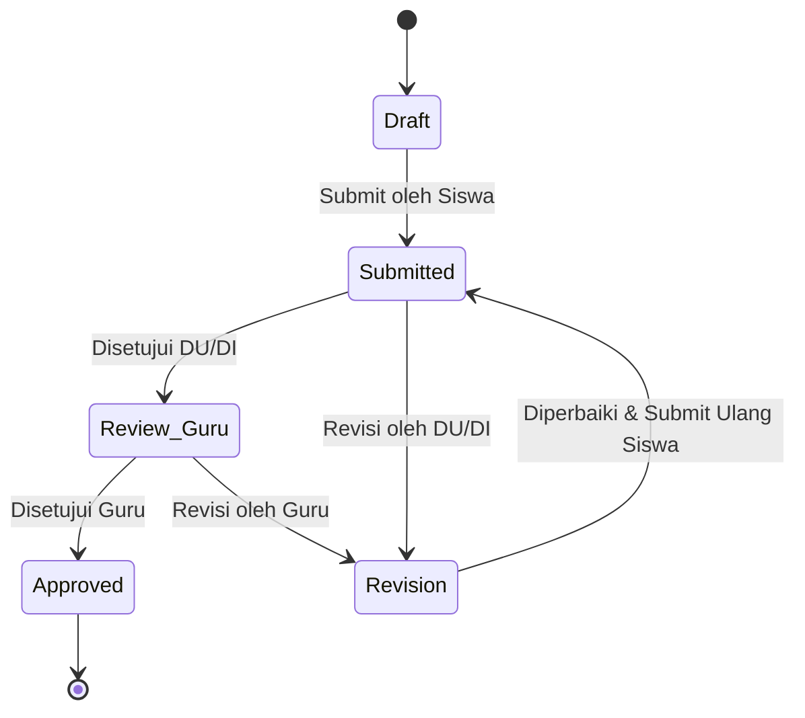

# Product Requirements Document (PRD)
## VokaTrack — Sistem Presensi & Jurnal PKL SMK Multi-Sekolah

| Atribut | Nilai |
|---|---|
| **Aplikasi** | VokaTrack |
| **Versi** | 1.3.0 |
| **Tipe Sistem** | Web Application (Multi-Tenant Scoped) |
| **Target Pengguna** | Super Admin, Admin Sekolah, Kepala Sekolah, Guru Pembimbing, Pembimbing DU/DI, Siswa |
| **Stack Inti** | Laravel 11, MySQL 8.0, Livewire 3, Tailwind CSS, DomPDF |
| **Prinsip Arsitektur** | Scalable, Modular, Maintainable, Konsisten UI |

---

## 1. Definisi & Ruang Lingkup

VokaTrack adalah aplikasi manajemen Praktik Kerja Lapangan (PKL) untuk SMK berbasis multi-sekolah dalam satu basis data bersama. Sistem menangani pencatatan kehadiran harian, permohonan presensi khusus, pengisian jurnal kerja industri berjenjang, evaluasi kompetensi, dan pembuatan dokumen rekapitulasi berkala.

### 1.1 Batasan Sistem
- **Multi-Tenant**: Satu instalasi melayani banyak sekolah. Data antar-sekolah terisolasi total melalui parameter `school_id`.
- **Akses Pengguna**: Siswa wajib menggunakan antarmuka mobile-first (viewport 360–430px). Pengelola (Admin, Guru, DU/DI, Kepsek) menggunakan antarmuka desktop/tablet.
- **Integritas Waktu**: Seluruh waktu presensi dan pengisian jurnal menggunakan waktu server (*WIB/WITA/WIT* berdasarkan konfigurasi sekolah). Waktu perangkat klien tidak diakui.

---

## 2. Matriks Peran & Hak Akses (RBAC)

| Peran | Ruang Lingkup | Hak Akses Utama |
|---|---|---|
| **Super Admin** | Lintas Sekolah (Platform) | 1. Registrasi & penonaktifan sekolah. 2. Pembuatan akun Admin Sekolah. 3. Konfigurasi SMTP & storage global. 4. Audit log platform & impersonasi akun. |
| **Admin Sekolah** | Satu Sekolah (`school_id`) | 1. Konfigurasi identitas sekolah (nama, logo, kop, TTD kepsek). 2. Pengaturan jam kerja default sekolah. 3. Master data: Jurusan, Kelas, Tahun Ajaran, Periode PKL. 4. CRUD akun: Guru Pembimbing, Kepsek, Siswa (Import Excel). 5. CRUD data Mitra DU/DI, akun Pembimbing DU/DI, & plotting siswa. |
| **Kepala Sekolah** | Satu Sekolah (`school_id`) | 1. Akses dashboard analitik agregat. 2. Monitoring rekapitulasi kehadiran dan status jurnal sekolah. 3. Pengunduhan laporan final berkala. |
| **Guru Pembimbing** | Siswa Bimbingan | 1. Monitoring absensi siswa binaan secara real-time. 2. Verifikasi & approval tingkat 2 jurnal kerja harian. 3. Verifikasi & approval pengajuan izin dan sakit. 4. Pengisian nilai pembimbingan sekolah. 5. Ekspor PDF laporan per siswa. |
| **Pembimbing DU/DI** | Siswa di Perusahaannya | 1. Validasi absensi harian siswa di lokasi kerja. 2. Verifikasi & approval tingkat 1 jurnal kerja harian. 3. Verifikasi & approval pengajuan dinas luar & luar kantor. 4. Pengisian nilai kompetensi industri. |
| **Siswa** | Data Pribadi | 1. Presensi check-in/check-out dengan kamera selfie. 2. Pengajuan presensi khusus (izin, sakit, dinas luar, luar kantor). 3. Input, draft, dan submit jurnal harian. 4. Memantau status approval, riwayat kehadiran, dan nilai akhir. |

---

## 3. Spesifikasi Fungsional

### 3.1 Manajemen Multi-Sekolah (Super Admin)

#### F-01: Administrasi Sekolah
- **Input**: Nama sekolah, NPSN (unik, 8-10 digit), alamat lengkap, email resmi, nomor telepon, status aktif (`true`/`false`).
- **Aturan Bisnis**:
  - Penambahan sekolah baru otomatis menghasilkan akun `admin-sekolah` awal dengan kredensial sementara.
  - Sekolah non-aktif (`is_active = false`) memblokir seluruh sesi login user yang terasosiasi dengan `school_id` tersebut.
  - Super Admin dapat melihat total sekolah aktif, total siswa terdaftar, dan estimasi storage per sekolah.

---

### 3.2 Konfigurasi Sekolah & Master Data (Admin Sekolah)

#### F-02: Identitas & Preferensi Sekolah
- **Branding**: Upload logo resmi (`PNG/WEBP`, maks 1MB), upload tanda tangan digital & stempel kepala sekolah (`PNG` transparan, maks 1MB), pengaturan teks kop surat.
- **Aturan Jam Kerja Default**:
  - `checkin_start`: Waktu awal tombol check-in aktif (default: `06:00`).
  - `checkin_late`: Batas akhir check-in tepat waktu (default: `08:00`). Melewati jam ini status menjadi `terlambat`.
  - `checkin_alfa`: Batas toleransi maksimal check-in harian (default: `11:00`). Melewati jam ini hari kerja dianggap `alfa`.
  - `checkout_start`: Waktu awal tombol check-out dapat ditekan (default: `16:00`).
- **Aturan Jurnal**:
  - `journal_backdate_limit`: Jumlah hari toleransi pengisian jurnal mundur (default: `3` hari).
- **Aturan Penilaian**:
  - Bobot persentase nilai DU/DI vs Guru Sekolah (default: `60% DU/DI : 40% Guru`).

#### F-03: Manajemen Mitra DU/DI & Penugasan
- **Data Perusahaan**: Nama DU/DI, alamat, penanggung jawab (PIC), nomor telepon kontak, hari kerja (`5_hari` / `6_hari`).
- **Aturan Geofencing (GPS) Fleksibel**:
  - `gps_enabled`: Boolean (default: `false`).
  - Jika `true`, kolom `latitude`, `longitude`, dan `radius_meters` (default `100` meter) wajib diisi.
- **Override Jam Kerja DU/DI**:
  - Jika DU/DI memiliki shift berbeda, Admin Sekolah dapat mengaktifkan jam kerja kustom yang mengesampingkan jam kerja default sekolah.
- **Plotting PKL**:
  - Siswa hanya dapat terhubung ke 1 entitas DU/DI aktif dalam 1 periode PKL.
  - Relasi penugasan memetakan: `siswa_id`, `company_id`, `pkl_period_id`, `guru_id`, `supervisor_id`.

#### F-04: Manajemen Siswa & Import Excel
- **Format Import**: File `.xlsx` / `.csv` dengan header: `nis`, `nisn`, `nama`, `kelas_id`, `email`, `jenis_kelamin`.
- **Validasi Import**: Duplikasi NISN atau email otomatis ditolak dan menghasilkan log baris gagal tanpa membatalkan baris yang valid.

---

### 3.3 Modul Presensi & Pengajuan Khusus

#### F-05: Presensi Harian Siswa (Check-In & Check-Out)
- **Check-In**:
  - Akses kamera wajib aktif via browser (foto selfie langsung, penolakan akses file gallery lokal).
  - Wajib menyertakan koordinat lintang/bujur perangkat saat tombol ditekan.
  - Jika DU/DI mengaktifkan GPS:
    - Jarak dihitung menggunakan formula Haversine.
    - Jika jarak > radius: form menampilkan peringatan luar radius dan mewajibkan siswa mengisi alasan lokasi. Record disimpan dengan `is_within_radius = false`.
  - Status kehadiran ditentukan otomatis berdasarkan jam masuk:
    - `waktu <= checkin_late` → `hadir`.
    - `checkin_late < waktu <= checkin_alfa` → `terlambat`.
    - Melewati `checkin_alfa` tanpa pengajuan presensi khusus → otomatis `alfa` via scheduled job pukul 23:59.
- **Check-Out**:
  - Aktif setelah siswa melakukan check-in dan telah memasuki jam `checkout_start`.
  - Input: Catatan ringkas capaian kerja hari ini (maks. 255 karakter).

#### F-06: Pengajuan Presensi Khusus

| Jenis | Dokumen Wajib | Verifikator | Efek Terhadap Presensi |
|---|---|---|---|
| **Izin** | Alasan tertulis (min. 20 karakter), foto surat izin (opsional) | Guru Pembimbing | Status tanggal bersangkutan menjadi `izin`. |
| **Sakit** | Alasan tertulis, foto surat dokter/keterangan medis | Guru Pembimbing | Status tanggal bersangkutan menjadi `sakit`. |
| **Dinas Luar** | Lokasi tujuan, deskripsi instruksi penugasan industri | Pembimbing DU/DI | Status tanggal bersangkutan menjadi `dinas_luar`. Sistem membebaskan validasi GPS. |
| **Luar Kantor (WFH)** | Foto selfie lokasi aktual, uraian pekerjaan | Pembimbing DU/DI | Status tanggal bersangkutan menjadi `luar_kantor`. Sistem membebaskan validasi GPS kantor. |

- **Aturan Alur Pengajuan**:
  - Permohonan yang diajukan berstatus `pending`.
  - Verifikator dapat melakukan aksi: `Approve` atau `Reject` (wajib menyertakan alasan penolakan).
  - Update status presensi terjadi secara atomik saat verifikator menekan tombol approve.

---

### 3.4 Modul Jurnal Harian PKL

#### F-07: Siklus Hidup Jurnal
1. **Penyusunan (Draft)**:
   - Satu hari kerja hanya memiliki 1 entri jurnal.
   - Kolom: Tanggal kegiatan, uraian pekerjaan (teks, min. 50 karakter), foto dokumentasi (1–3 file, kompresi otomatis ke maks 800KB).
   - Siswa dapat menyimpan sebagai status `draft`.
2. **Pengajuan (Submit)**:
   - Setelah disubmit, status berubah menjadi `submitted`. Data terkunci dari pengeditan langsung oleh siswa.
3. **Approval Tingkat 1 (Pembimbing DU/DI)**:
   - Pembimbing DU/DI memeriksa kebenaran teknis kegiatan di lapangan.
   - Pilihan:
     - `Approve` → status naik ke `review_guru`.
     - `Minta Revisi` → status menjadi `revision` (wajib menuliskan catatan revisi). Siswa menerima notifikasi dan hak edit terbuka kembali.
4. **Approval Tingkat 2 (Guru Pembimbing)**:
   - Guru memeriksa kesesuaian capaian kompetensi dengan kurikulum.
   - Pilihan:
     - `Approve` → status menjadi `approved` (final).
     - `Minta Revisi` → status menjadi `revision`.

---

### 3.5 Modul Evaluasi & Pelaporan

#### F-08: Penilaian Akhir
- Form nilai industri (DU/DI): Disiplin, Tanggung Jawab, Keterampilan Teknis, Inisiatif (skala 0–100).
- Form nilai sekolah (Guru): Kelengkapan Jurnal, Laporan Akhir, Presentasi/Bimbingan (skala 0–100).
- Nilai Akhir dihitung otomatis:
  $$\text{Nilai Akhir} = (\text{Rata-rata DU/DI} \times W_{\text{dudi}}) + (\text{Rata-rata Guru} \times W_{\text{sekolah}})$$

#### F-09: Dokumen Laporan (Ekspor)
- **PDF Laporan Individu Siswa**:
  - Format halaman portrait, margin standar 2cm.
  - Memuat Kop Surat dinamis dari database sekolah, identitas lengkap siswa, ringkasan kehadiran matriks, rekapan seluruh jurnal disetujui, lembar penilaian, dan tanda tangan digital.
- **Excel Rekapitulasi Kelas**:
  - Baris: Nama siswa, NISN.
  - Kolom: Tanggal 1 s.d. akhir bulan (berisi kode H, T, I, S, DL, LK, A), total ringkasan per status.

---

## 4. Antarmuka Pengguna (UI/UX Requirement)

### 4.1 Antarmuka Siswa (Mobile-First Mandatory)
- **Viewport**: Dioptimalkan untuk lebar 360px – 430px.
- **Struktur Halaman Utama**:
  1. **Sticky Topbar**: Logo sekolah, nama brand instansi, nama siswa, ikon notifikasi.
  2. **Card Status Hari Ini**:
     - Status presensi hari ini (*Hadir / Terlambat / Izin / Belum Absen*).
     - Waktu check-in dan check-out.
     - Tombol aksi utama: `[ 📷 Check-In ]` atau `[ Check-Out ]` dengan ukuran minimal 48px (standar aksesibilitas jempol).
  3. **Baris Permohonan Cepat**: Tombol pill berjejer: `Izin`, `Sakit`, `Dinas Luar`, `Luar Kantor`.
  4. **Card Status Jurnal**: Pengingat status jurnal hari ini (*Belum Diisi / Menunggu Review / Approved*).
  5. **Card Rekap Presensi Bulan Berjalan**: Indikator angka sederhana (*Hadir, Terlambat, Izin, Sakit, Alfa*).
- **Bottom Navigation**:
  - Menempel tetap (*fixed bottom*) dengan 4 item: `Beranda`, `Absensi`, `Jurnal`, `Profil`.
  - Tinggi 64px, safe-area padding untuk perangkat berponi/notch.

### 4.2 Antarmuka Pengelola (Admin, Guru, DU/DI, Kepsek)
- Layout berbasis sidebar kiri (dapat diciutkan/collapsible).
- Header atas memuat breadcrumb, indikator sekolah aktif, dan profil pengguna.
- Penyajian data tabular wajib menggunakan pagination sisi server, search debounce 300ms, dan filter status langsung.

---

## 5. Kebutuhan Non-Fungsional (NFR)

| Aspek | Spesifikasi Teknis |
|---|---|
| **Waktu Respon** | Rata-rata < 1.2 detik untuk query data standar; < 3 detik untuk generate file PDF. |
| **Isolasi Data** | Query model wajib melalui global scope `school_id`. Akses data sekolah lain menghasilkan exception `ModelNotFoundException` atau `403 Forbidden`. |
| **Integritas Gambar** | Seluruh upload gambar dikompresi di sisi klien sebelum transmisi (resolusi maks 1280px, kualitas 80%), dilanjutkan stripping EXIF di sisi server. |
| **Penyimpanan Berkas** | Penamaan berkas terisolasi: `schools/{school_id}/{kategori}/{tahun}/{hash}.ext`. Akses berkas lampiran privat melalui signed URL. |
| **Kompatibilitas** | Browser mobile: Chrome Android 90+, Safari iOS 14+. Desktop: Chrome, Firefox, Edge modern. |

---

## 6. Rencana Implementasi

| Fase | Target Luaran |
|---|---|
| **Fase 1: Inti & Multi-Tenant** | Setup Laravel 11, skema database dasar, implementasi `BelongsToSchool` Trait & Global Scope, autentikasi role Super Admin & Admin Sekolah. |
| **Fase 2: Konfigurasi & Master Data** | Pengaturan identitas sekolah, CRUD Jurusan, Kelas, DU/DI (GPS config), impor siswa Excel, plotting penugasan PKL. |
| **Fase 3: Presensi Mobile Siswa** | Tampilan mobile siswa (card + bottom nav), modul check-in kamera selfie, validasi jam kerja & radius GPS, scheduled job auto-alfa. |
| **Fase 4: Permohonan Khusus & Jurnal** | Alur pengajuan izin/sakit/dinas luar/luar kantor, form jurnal harian, two-tier approval DU/DI dan Guru. |
| **Fase 5: Penilaian, Ekspor, & QA** | Form nilai kompetensi, generator PDF laporan individual siswa (kop dinamis + TTD), rekap Excel, pengujian keamanan multi-tenant. |
