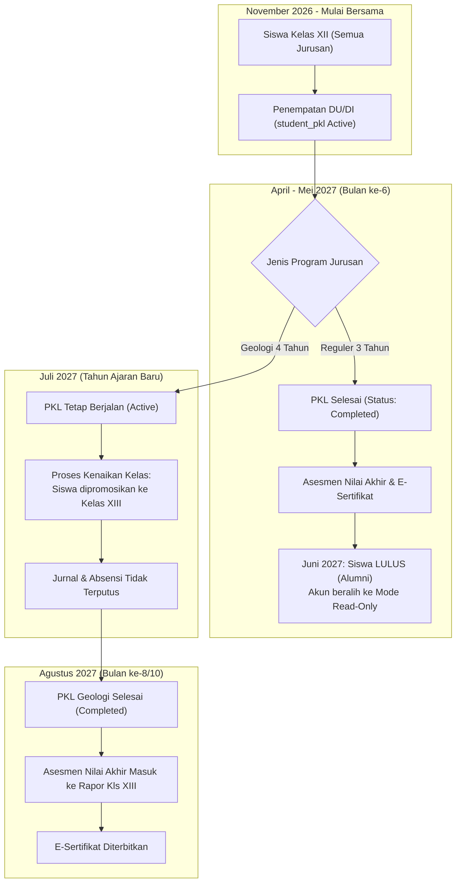
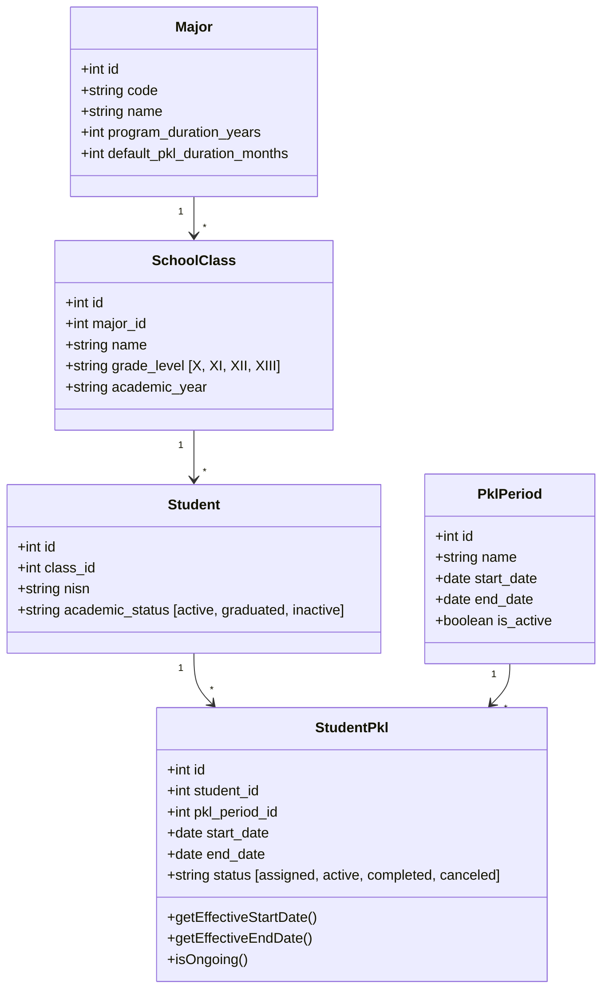
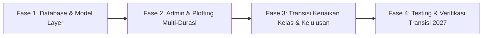

# Perencanaan Teknis: Penanganan SMK Program 4 Tahun (Kelas XIII) & Multi-Durasi PKL Lintas Tahun Ajaran

Dokumen ini merumuskan rencana implementasi teknis dan arsitektur untuk menangani perbedaan masa magang antara **Program SMK 3 Tahun** (maksimal 6 bulan, lulus di akhir kelas XII) dan **Program SMK 4 Tahun** seperti **Geologi Pertambangan** (magang 8–10 bulan, berlangsung lintas tahun ajaran, dan naik ke **Kelas XIII**).

Perencanaan ini dirancang berpegang pada prinsip: **Scalable**, **Modular**, **Mudah di-maintenance**, dan **Konsisten secara UI/UX**.

---

## 1. Studi Kasus & Identifikasi Masalah Riil

### Skenario Operasional
* **Periode Mulai:** November 2026 (seluruh siswa berada di Kelas XII).
* **Mei – Juni 2027 (Batas 6 Bulan):**
  * Siswa program reguler 3 tahun menyelesaikan magang.
  * Ujian akhir / sidang PKL dilakukan, nilai diinput, dan siswa dinyatakan **LULUS** pada akhir tahun ajaran 2026/2027.
* **Juli 2027 (Pergantian Tahun Ajaran 2027/2028):**
  * Sekolah melakukan proses pergantian tahun ajaran baru.
  * Siswa jurusan Geologi (program 4 tahun) **naik ke Kelas XIII**.
* **Agustus 2027 (Batas 8–10 Bulan):**
  * Siswa Geologi menyelesaikan masa PKL di industri.
  * Asesmen akhir PKL dilakukan dan sertifikat diterbitkan.



---

## 2. Audit Kesenjangan Sistem Eksisting (*Gap Analysis*)

Berdasarkan audit codebase saat ini:

| Komponen Codebase | Kondisi Saat Ini | Masalah yang Terjadi | Target Desain Baru |
| :--- | :--- | :--- | :--- |
| **`classes.grade_level`** | `enum('X', 'XI', 'XII')` di migrasi `2024_01_01_000004` dan validasi controller | Error validasi `in:X,XI,XII` saat membuat rombel Kelas XIII Geologi | Diperluas menjadi `enum('X', 'XI', 'XII', 'XIII')` |
| **`majors`** | Hanya menyimpan `code` dan `name` | Sistem tidak tahu jurusan mana yang 3 tahun vs 4 tahun, dan batas durasi magangnya | Menambahkan `program_duration_years` (3/4) dan `max_pkl_months` (default 6, geologi 8-10) |
| **`pkl_periods`** | Rentang tanggal tunggal global per periode | Mengunci tanggal seragam untuk semua siswa; jika periode berakhir Mei 2027, siswa Geologi terkunci | Mendukung periode per-jurusan atau custom override tanggal di `student_pkl` |
| **`student_pkl`** | Belum ada kolom `start_date` / `end_date` khusus kontrak | Tanggal sepenuhnya bergantung pada `pkl_periods`, padahal DUDI Geologi berbeda waktu penarikan | Tambah kolom opsional `start_date` & `end_date` di `student_pkl` dengan fallback ke periode |
| **Siklus Siswa (`students`)** | Hanya mengacu pada `class_id` | Tidak ada status kelulusan (`academic_status`); siswa yang lulus tetap bisa check-in jika tidak dinonaktifkan | Tambah status akademik siswa: `active`, `graduated`, `inactive` |

> [!NOTE]
> Keputusan desain awal di mana tabel `attendances` dan `journals` merujuk ke `student_pkl_id` (bukan ke `class_id`) adalah keunggulan arsitektural. Kenaikan kelas siswa dari XII ke XIII tidak akan merusak integritas relasional data absensi atau jurnal yang sudah terekam.

---

## 3. Arsitektur Solusi Modular

### A. Modul 1: Master Data Program Keahlian (`majors` & `classes`)
1. **Konfigurasi Jurusan:**
   * Setiap jurusan menyimpan atribut durasi program:
     * `program_duration_years`: `3` (umum) atau `4` (Geologi, dsb).
     * `default_pkl_duration_months`: default `6`, atau `8`/`10` bulan.
2. **Fleksibilitas Rombel:**
   * Mendukung kelas `XIII` untuk jurusan dengan `program_duration_years = 4`.
   * Form pembuatan kelas memvalidasi tingkat kelas berdasarkan konfigurasi jurusannya (misal: jurusan 3 tahun tidak dapat membuat kelas XIII).

### B. Modul 2: Fleksibilitas Periode & Kontrak Magang (`student_pkl`)
Sistem mengadopsi pendekatan **Hybrid Period**:
1. **Periode Induk (`pkl_periods`):** Sebagai payung administratif tahun ajaran (contoh: "PKL Angkatan 2026/2027").
2. **Kontrak Individual / Rombel (`student_pkl`):**
   * Di tabel `student_pkl` ditambahkan kolom opsional:
     * `start_date`: Tanggal riil mulai magang siswa (nullable, fallback ke `pkl_periods.start_date`).
     * `end_date`: Tanggal riil selesai magang siswa (nullable, fallback ke `pkl_periods.end_date`).
   * **Manfaat:** Ketika jurusan biasa selesai pada 30 April 2027, siswa Geologi diatur tanggal `end_date`-nya hingga 31 Agustus 2027.



### C. Modul 3: Engine Transisi Tahun Ajaran (Kenaikan Kelas & Kelulusan)
Pada pergantian tahun ajaran di bulan Juli 2027:
1. **Pemisahan Jalur Aksi Massal (*Mass Action*):**
   * **Jalur Kelulusan (Jurusan 3 Tahun):**
     * Mengubah `academic_status` siswa dari `active` $\rightarrow$ `graduated`.
     * Mengunci hak akses penulisan jurnal dan presensi.
     * Mengaktifkan mode **Alumni (Read-Only)**: Siswa tetap dapat login untuk mengunduh E-Sertifikat, transkrip nilai, dan cetak laporan PDF jurnal magang.
   * **Jalur Kenaikan Kelas (Jurusan 4 Tahun):**
     * Memindahkan siswa dari rombel `XII GP` $\rightarrow$ `XIII GP`.
     * Status `student_pkl` **TETAP AKTIF** (`active`) karena tanggal berakhirnya (`end_date`) adalah Agustus 2027.
     * Tidak ada interupsi pada aplikasi mobile/web siswa saat mengisi presensi GPS dan jurnal harian.

### D. Modul 4: Asinkron Asesmen & E-Sertifikat
* **Decoupled Assessment:** Fitur input nilai pembimbing DUDI dan guru pembimbing tidak mengunci antar-siswa.
* Guru pembimbing jurusan reguler dapat melakukan submit nilai dan mencetak sertifikat pada bulan Mei 2027 tanpa harus menunggu jurusan Geologi selesai.
* Siswa Geologi baru dinilai pada akhir Agustus 2027.

---

## 4. Rincian Perubahan Skema Database (*Database Migrations*)

### Migrasi 1: Update Enum Kelas & Setting Jurusan
```php
// database/migrations/2026_11_20_000001_support_grade_xiii_and_major_duration.php
Schema::table('classes', function (Blueprint $table) {
    // Memperluas enum grade_level mencakup XIII
    $table->string('grade_level', 10)->default('XII')->change();
});

Schema::table('majors', function (Blueprint $table) {
    $table->unsignedTinyInteger('program_duration_years')->default(3)->after('name');
    $table->unsignedTinyInteger('default_pkl_duration_months')->default(6)->after('program_duration_years');
});
```

### Migrasi 2: Custom Date & Status Siswa
```php
// database/migrations/2026_11_20_000002_add_dates_to_student_pkl_and_status_to_students.php
Schema::table('student_pkl', function (Blueprint $table) {
    $table->date('start_date')->nullable()->after('supervisor_id');
    $table->date('end_date')->nullable()->after('start_date');
    $table->index(['status', 'start_date', 'end_date'], 'idx_spkl_timeline');
});

Schema::table('students', function (Blueprint $table) {
    $table->enum('academic_status', ['active', 'graduated', 'inactive'])->default('active')->after('is_parent_portal_active');
    $table->year('graduation_year')->nullable()->after('academic_status');
    $table->index(['school_id', 'academic_status'], 'idx_students_academic_status');
});
```

---

## 5. Logika Bisnis (*Business Logic & Model Encapsulation*)

Di model `StudentPkl.php`, kita tambahkan accessor cerdas agar kode di seluruh controller tetap bersih dan konsisten:

```php
public function getEffectiveStartDateAttribute(): ?Carbon
{
    return $this->start_date ? Carbon::parse($this->start_date) : $this->pklPeriod?->start_date;
}

public function getEffectiveEndDateAttribute(): ?Carbon
{
    return $this->end_date ? Carbon::parse($this->end_date) : $this->pklPeriod?->end_date;
}

public function isPklActiveToday(): bool
{
    if ($this->status !== 'active') return false;
    
    $today = Carbon::today();
    $start = $this->effective_start_date;
    $end = $this->effective_end_date;

    if ($start && $today->lt($start)) return false;
    if ($end && $today->gt($end)) return false;

    return true;
}
```

> [!TIP]
> Dengan memanfaatkan accessor `$spkl->effective_start_date` dan `$spkl->effective_end_date`, bug perhitungan hari magang yang sempat terjadi di `StudentController` (akibat memanggil properti `$spkl->start_date` yang belum ada di database) dapat langsung teratasi secara elegan dengan fallback ke periode induk.

---

## 6. Penyesuaian Konsistensi Antarmuka (UI/UX)

1. **Dashboard & Halaman Plotting Admin / Kajur:**
   * Menambahkan dropdown filter tingkat kelas: `Semua`, `Kelas XI`, `Kelas XII`, `Kelas XIII`.
   * Pada tabel penugasan PKL, tampilkan badge identitas durasi:
     * Badge Hijau: `<span class="badge">Reguler (6 Bln)</span>`
     * Badge Ungu: `<span class="badge">Geologi / 4 Thn (8-10 Bln)</span>`
   * Menampilkan tanggal rentang efektif per siswa secara transparan (`01 Nov 2026 - 31 Agu 2027`).

2. **Halaman Pengaturan Jurusan & Kelas:**
   * Form Jurusan: Input pilihan tipe program:
     * `🔘 Program 3 Tahun (Reguler)`
     * `🔘 Program 4 Tahun (Khusus Industri / Fast Track)`
   * Form Kelas: Dropdown tingkat kelas otomatis menampilkan opsi `XIII` hanya jika jurusan yang dipilih bertipe 4 tahun.

3. **Status Akun Siswa Lulus (Alumni Portal):**
   * Ketika siswa berstatus `graduated`, dashboard siswa menampilkan header informatif:
     > *"Status Anda: Alumni (Lulus Tahun Ajaran 2026/2027). Akun berada dalam mode arsip."*
   * Form check-in absensi dan tombol kirim jurnal disembunyikan/dinonaktifkan secara rapi, sementara tombol **"Cetak E-Sertifikat"** dan **"Unduh Rekap Jurnal PDF"** tetap dapat diakses bebas.

---

## 7. Rencana Tahapan Eksekusi (*Phased Implementation Roadmap*)



### Fase 1: Database & Model Layer
* Buat migrasi untuk mendukung `grade_level` XIII, konfigurasi `majors`, custom dates di `student_pkl`, dan status `academic_status` di `students`.
* Update model `Major`, `SchoolClass`, `Student`, dan `StudentPkl` dengan relasi, scopes, dan accessor tanggal efektif.

### Fase 2: Admin & Plotting Multi-Durasi
* Update `AdminSekolahController`:
  * Validasi `storeClass` & `updateClass` agar menerima nilai `'XIII'`.
  * Form `storeMajor` & `updateMajor` mendukung `program_duration_years` & `default_pkl_duration_months`.
  * Form plotting (`storePlotting`) otomatis mengisi tanggal selesai default sesuai durasi jurusan (atau input manual rentang tanggal).

### Fase 3: Transisi Kenaikan Kelas & Kelulusan
* Sediakan antarmuka sederhana bagi Admin Sekolah untuk melakukan:
  1. **Kenaikan Kelas Massal:** Memindahkan rombel siswa kelas XII ke XIII (khusus jurusan 4 tahun).
  2. **Set Kelulusan:** Menandai siswa kelas XII jurusan 3 tahun menjadi `graduated`.
* Pasang proteksi middleware agar akun `graduated` tidak dapat mengirim absensi/jurnal baru tetapi tetap dapat melihat arsip.

### Fase 4: Testing & Verifikasi Transisi
* Unit test untuk accessor tanggal efektif `StudentPkl`.
* Feature test untuk simulasi pengisian presensi siswa Geologi di bulan Juli & Agustus 2027 saat siswa sudah berada di Kelas XIII.
* Feature test untuk memastikan siswa yang sudah lulus tidak bisa mengisi presensi lagi di bulan Juli 2027.

---

## 8. Poin Keputusan yang Memerlukan Konfirmasi Pengguna

Sebelum kita melangkah ke implementasi kode, ada beberapa opsi teknis yang dapat disesuaikan dengan SOP sekolah Anda:

1. **Fleksibilitas Input Tanggal:**
   * Apakah saat Admin memplot siswa PKL, tanggal mulai dan tanggal selesai ingin **otomatis terisi dari master jurusan**, atau **Admin ingin bisa mengubah tanggal spesifik per siswa/perusahaan**?
2. **Kenaikan Kelas:**
   * Apakah di sekolah Anda pergantian nama rombel di kelas XIII mengikuti pola otomatis (misal: `XII GP 1` $\rightarrow$ `XIII GP 1`), atau Admin sekolah lebih nyaman membuat kelas baru secara manual lalu memindahkan siswanya?
