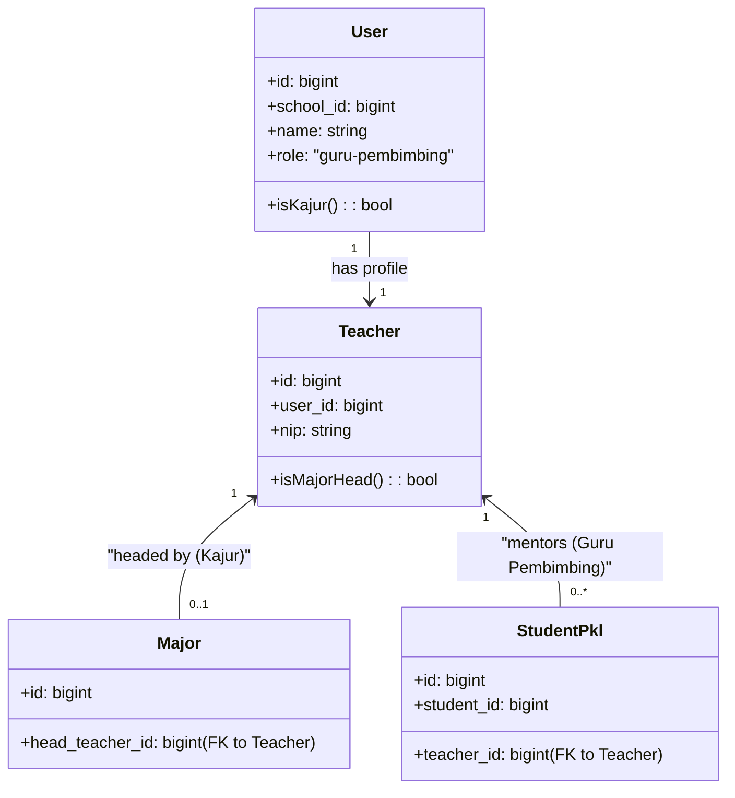
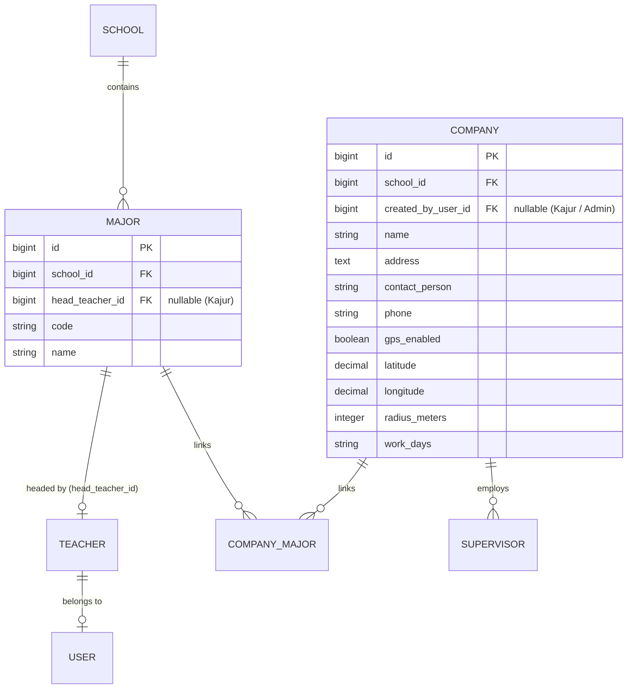
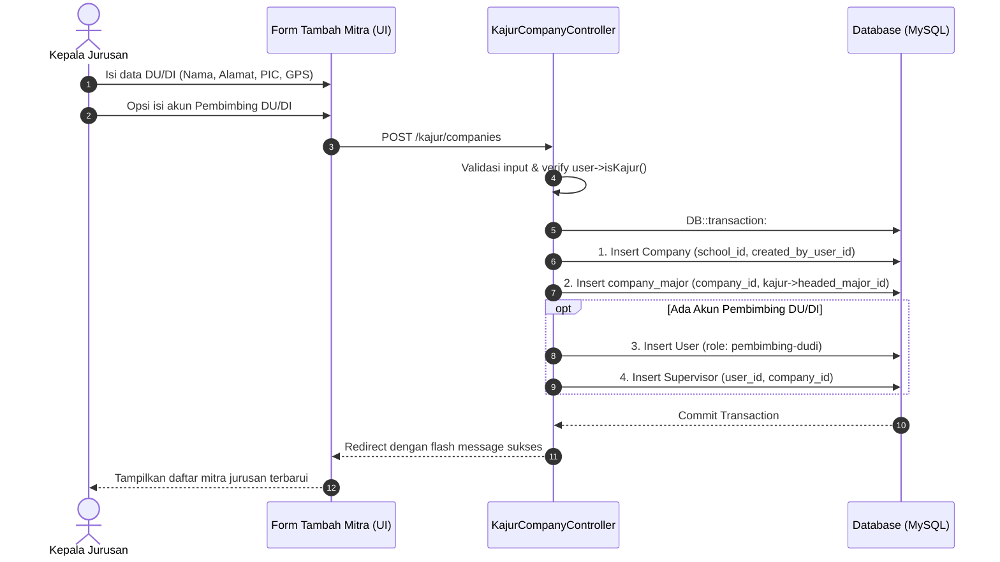

# Rencana Arsitektur & Spesifikasi Fitur: Kepala Jurusan / Kepala Program Keahlian (Kaprog)
## VokaTrack — Sistem Manajemen PKL SMK Multi-Sekolah

| Parameter | Keterangan |
|---|---|
| **Aplikasi** | VokaTrack |
| **Modul** | Peran & Akses Kepala Jurusan (Kaprog / Kakomli) |
| **Versi Dokumen** | 1.0.0 |
| **Tanggal** | 17 November 2026 |
| **Status** | Draf Perencanaan Siap Implementasi |
| **Prinsip Dasar** | Scalable, Modular, Mudah di-Maintenance, Konsisten UI |
| **Dokumen Acuan** | [PRD-sistem-pkl-smk.md](../PRD-sistem-pkl-smk.md), [DESIGN.md](../DESIGN.md), [DOKUMENTASI-FITUR.md](../DOKUMENTASI-FITUR.md) |

---

## 1. Latar Belakang & Urgensi

Dalam struktur organisasi SMK di Indonesia, kegiatan Praktik Kerja Lapangan (PKL) dijalankan secara desentralisasi berbasis keahlian:
1. **Kepala Sekolah**: Memantau statistik agregat sekolah dan menandatangani dokumen/sertifikat resmi.
2. **Admin Sekolah**: Mengelola konfigurasi tenant, master data umum, akun pengguna, dan pengaturan sistem sekolah.
3. **Kepala Program Keahlian (Kaprog / Kajur)**: Bertanggung jawab penuh terhadap **keselarasan teknis industri, relevansi kurikulum, relasi kemitraan DU/DI kejuruan, dan distribusi guru pembimbing** di jurusannya masing-masing.
4. **Guru Pembimbing**: Mengawal langsung kelompok siswa binaannya di lapangan.

Ketiadaan peran Kepala Jurusan sebelumnya menyebabkan:
- Admin Sekolah terbebani mengurus administrasi mikro setiap jurusan (misal: mencari mitra industri spesifik jurusan, menentukan plotting pembimbing).
- Guru pembimbing tidak memiliki pimpinan lini teknis untuk eskalasi kendala kompetensi atau insiden di industri.
- Sekolah kesulitan memetakan kemitraan DU/DI yang relevan dengan masing-masing Program Keahlian.

---

## 2. Fitur & Spesifikasi Fungsional Kepala Jurusan

### 2.1 Manajemen Kemitraan DU/DI (Fitur Khusus Kajur)
> **Catatan Utama**: Kepala Jurusan diberikan wewenang penuh untuk **menambahkan, memvalidasi, dan mengelola mitra perusahaan (DU/DI)** yang relevan dengan jurusannya.

#### Alur Penambahan Mitra Perusahaan:
1. **Formulir Pendaftaran Perusahaan**:
   - Informasi Umum: Nama Perusahaan, Alamat Kantor/Pabrik, Penanggung Jawab (PIC / HRD), Nomor Telepon/WhatsApp resmi, Email.
   - Pengaturan Kerja: Hari kerja (`5_days` atau `6_days`).
   - Geofencing (GPS): Opsi aktifkan koordinat (`latitude`, `longitude`, `radius_meters`).
   - Jam Kerja Khusus: Opsi jam kerja kustom (override jam default sekolah).
2. **Keterikatan Otomatis ke Jurusan (`company_major`)**:
   - Saat Kajur menyimpan data perusahaan, sistem secara otomatis menghubungkan entitas `companies` dengan `major_id` milik Kajur pada tabel pivot `company_major`.
   - Kajur juga dapat menandai jika perusahaan tersebut dapat menerima siswa dari jurusan lain yang masih satu rumpun (multi-major).
3. **Pendaftaran Pembimbing Industri (Supervisor DU/DI)**:
   - Kajur dapat langsung mendaftarkan 1 akun awal pembimbing DU/DI (nama, email, jabatan, no HP) bersamaan dengan input perusahaan, sehingga mempercepat proses onboarding industri.
4. **Audit Trail & Kepemilikan**:
   - Kolom `created_by_user_id` mencatat Kajur yang mendaftarkan perusahaan tersebut untuk transparansi histori.

---

### 2.2 Dashboard & Monitoring Jurusan (Department Analytics)
- **Ringkasan Metrik**:
  - Total Siswa Aktif PKL pada jurusannya.
  - Jumlah Siswa Belum Terplotting DU/DI / Belum Dapat Tempat.
  - Statistik Presensi Hari Ini (Hadir Tepat Waktu, Terlambat, Izin/Sakit, Alfa).
  - Jumlah Jurnal Pending Verifikasi Guru Pembimbing.
  - Total Kemitraan DU/DI Aktif pada jurusannya.
- **Peta Sebaran Siswa**:
  - Visualisasi ringkas lokasi DU/DI tempat siswa jurusannya ditempatkan.

---

### 2.3 Tata Kelola Plotting & Guru Pembimbing
- **Plotting Kelompok PKL Jurusan**:
  - Memetakan siswa jurusannya ke DU/DI mitra dan menugaskan Guru Pembimbing dari daftar guru produktif jurusan terkait.
- **Monitoring Kunjungan Supervisi Guru**:
  - Rekapitulasi log kunjungan supervisi (`supervision_visits`) guru pembimbing ke mitra industri: tanggal kunjungan, catatan evaluasi, foto bukti kunjungan, dan tanda tangan industri.
- **Peringatan Beban Pembimbing**:
  - Menampilkan indikator kuota bimbingan guru (misal: 1 guru idealnya membimbing 8–12 siswa).

---

### 2.4 Monitoring Presensi & Jurnal Khusus Jurusan
- **Akses Presensi Real-Time**:
  - Memantau presensi seluruh siswa di jurusannya per hari/bulan dengan filter kelas.
  - Notifikasi instan jika ada siswa jurusannya yang terindikasi mangkir (alfa) berturut-turut.
- **Monitoring & Eskalasi Jurnal**:
  - Membaca jurnal kerja siswa di jurusannya untuk memastikan pekerjaan yang dilakukan di industri selaras dengan silabus kurikulum kejuruan.
  - Bertindak sebagai penengah jika terjadi *dispute* approval jurnal antara DU/DI dan Guru Pembimbing.

---

### 2.5 Rekapitulasi Nilai & Laporan Jurusan
- **Review Nilai PKL Jurusan**:
  - Meninjau rekap nilai akhir kombinasi (Nilai Industri DU/DI + Nilai Guru Pembimbing) untuk seluruh siswa di jurusannya.
- **Ekspor Dokumen Jurusan**:
  - Download Buku Induk PKL Jurusan / Rekapitulasi Nilai per kelas format Excel & PDF.

---

## 3. Kasus Khusus: Kepala Jurusan Merangkap Guru Pembimbing (Dual-Role Architecture)

Dalam operasional nyata di SMK, **Kepala Jurusan hampir selalu merangkap sebagai Guru Pembimbing** untuk sejumlah siswa binaan tertentu. Sistem VokaTrack dirancang untuk menangani rangkap jabatan ini secara **anggun (*seamless*), tanpa duplikasi akun, dan bebas konflik wewenang**.

### 3.1 Model Identitas Tunggal (Single Identity, Multi-Capability)

Arsitektur database VokaTrack menganut prinsip:
> **"Setiap Kepala Jurusan pada dasarnya adalah Guru (Pendidik), namun tidak semua Guru adalah Kepala Jurusan."**



- **Satu Akun, Satu Login**: User memiliki 1 baris di tabel `users` (dengan role dasar `'guru-pembimbing'`) dan 1 profil di tabel `teachers`.
- **Kapabilitas Dinamis**:
  - Sebagai **Guru Pembimbing**: Terhubung ke baris siswa di `student_pkl` melalui `student_pkl.teacher_id = teachers.id`.
  - Sebagai **Kepala Jurusan**: Terhubung ke jurusan di `majors` melalui `majors.head_teacher_id = teachers.id`.
- **Tidak Memerlukan Akun Ganda**: Guru tidak perlu logout-login atau menghafal dua email/password.

---

### 3.2 Pemisahan Konteks Tugas & Wewenang

Agar antarmuka tidak membingungkan dan alur kerja tetap teratur, sistem membedakan secara tegas kapan user bertindak sebagai **Guru Pembimbing** dan kapan bertindak sebagai **Kepala Jurusan**:

| Area Pekerjaan | Sebagai Guru Pembimbing (Siswa Binaan Sendiri) | Sebagai Kepala Jurusan (Seluruh Jurusan) |
|---|---|---|
| **Cakupan Siswa** | Terbatas pada kelompok siswa binaannya (contoh: 8–15 siswa). | Seluruh siswa di jurusannya (contoh: 100+ siswa dari 3 kelas). |
| **Mitra Perusahaan (DU/DI)** | Mengetahui profil DU/DI tempat binaannya bekerja. | **Menambahkan mitra DU/DI baru**, mengelola kuota, dan membuat akun pembimbing industri. |
| **Penetapan Plotting** | Menerima penugasan siswa dari sekolah/Kajur. | **Menetapkan siswa ke DU/DI** dan memilih guru pembimbing (termasuk menugaskan dirinya sendiri). |
| **Approval Jurnal Harian** | **Melakukan Verifikasi & Approval Tingkat 2** harian untuk siswa binaannya. | Memantau metrik progres verifikasi jurnal se-jurusan (*Monitoring View*). |
| **Presensi & Izin/Sakit** | Memvalidasi surat izin/sakit siswa binaannya. | Memantau rekap absensi harian, keterlambatan, dan peringatan siswa mangkir se-jurusan. |
| **Kunjungan Supervisi** | Mengisi logbook & bukti foto kunjungan supervisi ke industri binaannya. | Memantau seluruh rekap kunjungan supervisi yang dilakukan oleh rekan-rekan guru di jurusannya. |
| **Penilaian Akhir** | Menginput **Nilai Pembimbing Sekolah (bobot 40%)** untuk siswa binaannya. | **Memvalidasi & menandatangani rekapitulasi nilai akhir** jurusan sebelum diajukan ke Kepala Sekolah. |

---

### 3.3 Penanganan Alur Kerja & Mencegah Konflik Wewenang

#### 1. Pembagian Beban Plotting Mandiri (Self-Assignment)
Saat Kajur membuka modul plotting siswa di jurusannya (`/kajur/students`):
- Pada dropdown pemilihan Guru Pembimbing, nama Kajur akan muncul bersama guru-guru lainnya dengan label informatif:
  ```text
  [Pilih Guru Pembimbing]
  - Drs. Ahmad Fauzi (Anda / Kepala Jurusan) [Beban: 5/12 Siswa]
  - Siti Nurhaliza, S.Kom. [Beban: 10/12 Siswa]
  - Budi Santoso, S.T. [Beban: 8/12 Siswa]
  ```
- Kajur dapat secara transparan menugaskan kelompok siswa tertentu kepada dirinya sendiri sesuai kuota jam mengajar yang dimilikinya.

#### 2. Integritas Approval Jurnal
- **Siswa Binaan Sendiri**: Saat jurnal masuk dari siswa binaannya, jurnal tersebut masuk ke antrean approval reguler di portal bimbingannya (`/guru/journals`).
- **Siswa Guru Lain**: Pada dashboard Kajur (`/kajur/journals`), jurnal siswa lain berstatus **Read-Only** (hanya untuk pengawasan mutu).
- **Emergency Override (Eskalasi Darurat)**: Jika ada guru pembimbing lain yang berhalangan hadir/sakit lebih dari 5 hari kerja, sistem menyediakan tombol khusus bagi Kajur: `[Verifikasi Darurat / Delegasi]` dengan kewajiban mengisi alasan override yang tercatat pada *Audit Activity Log*.

---

### 3.4 Desain Antarmuka: Context Switcher & Unified Experience

Untuk menjaga **konsistensi UI** dan tidak membebani guru dengan menu sidebar yang terlalu panjang, diterapkan strategi **Dual-Context Navigation**:

#### 1. Header Context Switcher
Di pojok kanan atas layout desktop ([app.blade.php](file:///c:/Users/skala/OneDrive/Documents/project/pkl/resources/views/layouts/app.blade.php)), jika sistem mendeteksi `auth()->user()->isKajur() == true`, ditampilkan toggle pemilih mode yang elegan:

```html
<!-- Komponen Switcher Konteks di Header -->
<div class="relative inline-flex items-center bg-slate-100 p-1 rounded-xl border border-slate-200">
    <!-- Mode Kepala Jurusan -->
    <a href="{{ route('kajur.dashboard') }}" 
       class="flex items-center gap-2 px-3 py-1.5 text-xs font-semibold rounded-lg transition-all {{ request()->is('kajur*') ? 'bg-white text-emerald-700 shadow-sm' : 'text-slate-600 hover:text-slate-900' }}">
        <svg class="w-4 h-4 text-emerald-600" ...></svg>
        <span>Kepala Jurusan ({{ $user->headedMajor()->code }})</span>
    </a>
    
    <!-- Mode Guru Pembimbing -->
    <a href="{{ route('guru.dashboard') }}" 
       class="flex items-center gap-2 px-3 py-1.5 text-xs font-semibold rounded-lg transition-all {{ request()->is('guru*') ? 'bg-white text-indigo-700 shadow-sm' : 'text-slate-600 hover:text-slate-900' }}">
        <svg class="w-4 h-4 text-indigo-600" ...></svg>
        <span>Bimbingan Saya ({{ $user->teacher->studentPkls()->count() }})</span>
    </a>
</div>
```

#### 2. Cross-Linking pada Dashboard
- **Saat berada di Dashboard Kajur (`/kajur/dashboard`)**:
  Terdapat kartu *Quick Summary* yang menonjol di sisi atas:
  > **💼 Siswa Bimbingan Anda**: Anda membimbing **8 siswa**. Terdapat **3 jurnal baru** yang menunggu verifikasi Anda.  
  > `[Buka Antrean Approval Jurnal Saya →]`
- **Saat berada di Dashboard Guru (`/guru/dashboard`)**:
  Terdapat notifikasi/badge kecil di bagian atas:
  > **🏛️ Anda adalah Kepala Jurusan RPL**: Terdapat **2 mitra DU/DI baru** dan **5 siswa belum ter-plotting**.  
  > `[Masuk ke Panel Manajemen Jurusan →]`

---

## 4. Matriks Hak Akses & Keamanan (RBAC)

Akses Kepala Jurusan menerapkan prinsip **Scoped Least Privilege**:
$$\text{Scope Data} = \text{school\_id} = \text{Auth::user()->school\_id} \quad \land \quad \text{major\_id} = \text{Auth::user()->headed\_major\_id}$$

### Matriks Komparasi Hak Akses

| Modul / Fitur | Admin Sekolah | Kepala Sekolah | Kepala Jurusan (Kajur) | Guru Pembimbing | Siswa |
|---|:---:|:---:|:---:|:---:|:---:|
| **Konfigurasi Tenant & Jam Sekolah** | Full CRUD | Read-only | Tidak Ada Akses | Tidak Ada Akses | Tidak Ada Akses |
| **Tambah Mitra Perusahaan (DU/DI)** | Full CRUD (Semua) | Read-only | **Create & Edit (Jurusannya)** | Read-only (Terkait) | Read-only |
| **Tambah Akun Pembimbing DU/DI** | Full CRUD | Read-only | **Create & Edit (Mitra Jurusannya)** | Read-only | Tidak Ada Akses |
| **Master Jurusan & Kelas** | Full CRUD | Read-only | Read-only (Jurusannya) | Read-only | Read-only |
| **Master Siswa** | Full CRUD | Read-only | Read & Edit Info PKL Jurusannya | Read-only (Binaan) | Profil Sendiri |
| **Plotting Pembimbing & DU/DI** | Full CRUD | Read-only | **Manage Plotting Jurusannya** | Read-only | Read-only |
| **Monitoring Presensi** | Semua Jurusan | Agregat | **Semua Siswa Jurusannya** | Siswa Binaannya | Diri Sendiri |
| **Approval Jurnal Siswa** | Override | Read-only | Read-only & Review Eskalasi | **Approval Tingkat 2** | Submit Jurnal |
| **Supervisi / Kunjungan DU/DI** | Semua | Agregat | **Pantau Kunjungan Guru Jurusan** | Input Kunjungan Sendiri | Read-only |
| **Rekap Nilai PKL** | Semua | Pengesahan | **Validasi Rekap Jurusan** | Input Nilai Binaan | Nilai Akhir |

### Perlindungan Keamanan (IDOR & Tenant Isolation):
1. **Pencegahan IDOR Perusahaan**:
   Kajur hanya berhak mengedit atau menambah data mitra yang memiliki relasi pada tabel `company_major` yang sesuai dengan `major_id`-nya. Kajur tidak diizinkan mengubah pengaturan mitra yang didaftarkan khusus jurusan lain.
2. **Pencegahan Akses Siswa Lintas Jurusan**:
   Setiap endpoint `/kajur/*` menerapkan middleware dan policy yang memvalidasi bahwa entitas yang diminta (`Student`, `SchoolClass`, `StudentPkl`) terhubung ke jurusan yang dikepalai.

---

## 5. Desain Arsitektur Teknis & Database

### 5.1 Skema Database & Migrasi

Agar arsitektur **scalable** dan mendukung kondisi guru yang merangkap jabatan, penugasan Kepala Jurusan dimodelkan pada tabel `majors` dengan referensi ke tabel `teachers`.



#### Migrasi 1: Menambahkan `head_teacher_id` pada `majors`
```php
Schema::table('majors', function (Blueprint $table) {
    $table->foreignId('head_teacher_id')
          ->nullable()
          ->after('name')
          ->constrained('teachers')
          ->nullOnDelete();
});
```

#### Migrasi 2: Menambahkan `created_by_user_id` pada `companies`
```php
Schema::table('companies', function (Blueprint $table) {
    $table->foreignId('created_by_user_id')
          ->nullable()
          ->after('school_id')
          ->constrained('users')
          ->nullOnDelete();
});
```

---

### 4.2 Pemodelan Eloquent & Relasi (Modular)

#### Relasi pada Model `Major.php`:
```php
public function headTeacher(): BelongsTo
{
    return $this->belongsTo(Teacher::class, 'head_teacher_id');
}
```

#### Helper pada Model `Teacher.php`:
```php
public function headedMajors(): HasMany
{
    return $this->hasMany(Major::class, 'head_teacher_id');
}

public function isMajorHead(): bool
{
    return $this->headedMajors()->exists();
}
```

#### Helper pada Model `User.php`:
```php
public function isKajur(): bool
{
    return $this->teacher && $this->teacher->isMajorHead();
}

public function getHeadedMajorIdsAttribute(): array
{
    return $this->teacher?->headedMajors()->pluck('id')->toArray() ?? [];
}
```

---

### 4.3 Policy & Scoping (Mudah di-Maintenance)

Buat Trait `BelongsToHeadedMajor` atau Query Scope terpusat:

```php
// app/Traits/ScopesToMajorHead.php
namespace App\Traits;

use App\Models\User;
use Illuminate\Database\Eloquent\Builder;

trait ScopesToMajorHead
{
    public function scopeForMajorHead(Builder $query, User $user): Builder
    {
        $majorIds = $user->headed_major_ids;
        
        return $query->where('school_id', $user->school_id)
            ->whereHas('schoolClass', function ($q) use ($majorIds) {
                $q->whereIn('major_id', $majorIds);
            });
    }
}
```

#### Authorization Policy untuk Input Mitra Perusahaan:
```php
// app/Policies/CompanyPolicy.php
public function createByKajur(User $user): bool
{
    return $user->isKajur();
}

public function updateByKajur(User $user, Company $company): bool
{
    if (!$user->isKajur() || $company->school_id !== $user->school_id) {
        return false;
    }
    
    // Boleh edit jika terhubung ke jurusan yang dipimpinnya
    return $company->majors()
        ->whereIn('majors.id', $user->headed_major_ids)
        ->exists();
}
```

---

## 6. Alur & Logika Penambahan Mitra Perusahaan oleh Kajur



### Keunggulan Arsitektur Ini:
1. **Scalable**: Satu perusahaan dapat digunakan bersama oleh banyak jurusan melalui relasi `company_major` tanpa duplikasi record perusahaan.
2. **Modular**: Kontroler `KajurCompanyController` menggunakan logic yang terpisah dari `AdminSekolahController`, namun memanfaatkan schema data yang sama.
3. **Data Integrity**: Menggunakan transaksi basis data (`DB::transaction`) untuk memastikan integritas data perusahaan, relasi jurusan, dan akun supervisor.

---

## 7. Desain Navigasi & Konsistensi UI

Tampilan Kepala Jurusan mengadopsi standar antarmuka VokaTrack di `resources/views/layouts/app.blade.php`:
- Menggunakan skema warna yang konsisten: Navigasi Sidebar bernuansa profesional, Badge Status (Hijau, Kuning, Merah, Biru).
- Terintegrasi dengan fitur **Role Switcher** di header atas jika seorang Guru sekaligus menjabat sebagai Kajur:
  ```html
  <!-- Switcher Mode Guru / Kajur -->
  <div class="flex items-center space-x-2 bg-emerald-50 px-3 py-1.5 rounded-lg border border-emerald-200">
      <span class="text-xs font-medium text-emerald-800">Mode Aktif:</span>
      <select onchange="window.location.href=this.value" class="text-xs font-semibold text-emerald-900 bg-transparent border-none focus:ring-0 cursor-pointer">
          <option value="{{ route('kajur.dashboard') }}" selected>Kepala Jurusan ({{ $majorName }})</option>
          <option value="{{ route('guru.dashboard') }}">Guru Pembimbing</option>
      </select>
  </div>
  ```

### Struktur Menu Sidebar `/kajur/*`:
```text
├── 📊 Dashboard Jurusan       (/kajur/dashboard)
├── 🏢 Mitra Perusahaan (DU/DI) (/kajur/companies)   <-- Termasuk Tambah Mitra
├── 👥 Siswa & Plotting PKL    (/kajur/students)
├── 📅 Rekap Presensi          (/kajur/attendance)
├── 📝 Monitoring Jurnal       (/kajur/journals)
├── 📋 Supervisi Guru          (/kajur/supervisions)
└── 📑 Rekapitulasi Nilai      (/kajur/grades)
```

---

## 8. Rencana Tahapan Implementasi (Roadmap)

| Fase | Target Pekerjaan | Luaran Teknis |
|:---:|---|---|
| **Fase 1: Database & Model** | - Migration `head_teacher_id` pada `majors`<br>- Migration `created_by_user_id` pada `companies`<br>- Relasi Eloquent di `Major`, `Teacher`, `User`, `Company` | Migration file & unit test relasi |
| **Fase 2: Middleware & Keamanan** | - Middleware `EnsureIsMajorHead`<br>- Policy `CompanyPolicy` & `StudentPolicy` untuk Kajur<br>- Pengaturan Route Group `/kajur` | Proteksi route & uji IDOR lolos |
| **Fase 3: Modul Mitra DU/DI** | - Controller `KajurCompanyController`<br>- View Form Tambah/Edit Mitra DU/DI<br>- Otomasi pengait ke `company_major`<br>- Pembuatan akun pembimbing industri oleh Kajur | Kajur dapat CRUD mitra jurusannya |
| **Fase 4: Monitoring & Supervisi** | - Dashboard metrik jurusan<br>- View Monitoring Presensi & Jurnal per kelas<br>- Rekap supervisi kunjungan guru pembimbing | Monitoring operasional jurusan aktif |
| **Fase 5: Rekapitulasi Nilai & UI** | - Halaman rekapitulasi nilai akhir jurusan<br>- Integrasi sidebar menu di `layouts/app.blade.php`<br>- Ekspor Excel/PDF laporan jurusan | Fitur lengkap & konsisten secara visual |

---

## 9. Verifikasi & Pengujian (Quality Assurance)

Sebelum dirilis, modul Kepala Jurusan wajib melewati skenario pengujian:
1. **Pengujian Multi-Tenant**: Memastikan Kajur di Sekolah A tidak dapat melihat mitra, siswa, atau jurusan di Sekolah B.
2. **Pengujian Isolasi Jurusan**: Memastikan Kajur RPL tidak dapat memodifikasi plotting atau melihat data presensi jurusan Akuntansi/Otomotif.
3. **Pengujian Tambah Perusahaan**:
   - Kajur sukses menambah mitra baru dan otomatis muncul di daftar mitra jurusannya.
   - Pendaftaran akun supervisor DU/DI otomatis mengirim kredensial/membuat akun aktif.
4. **Pengujian Role Switcher**: Guru yang merangkap Kajur dapat berpindah peran dengan lancar tanpa merusak sesi autentikasi.
